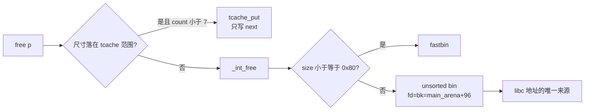

## 一句话结论

堆题里所有「为什么申请 0x18 / 0x28 / 0x38」的疑问，答案都在 `request2size` 和 bin 分档；所有「libc 地址从哪来」的疑问，答案都在 **unsorted bin 挂链时 glibc 自己写下的 `fd/bk = main_arena+96`**。

## chunk 结构

64 位下 chunk 头 16 字节，用户区从 `chunk+0x10` 开始；当前块 inuse 时，下一个 chunk 的 `prev_size` 那 8 字节可以被当前块借用。

```text
chunk 头                          用户区（malloc 返回值）
+----------------+----------------+----------------+----------------+
| prev_size (8)  | size (8)       | fd / next (8)  | bk / key (8)   |
+----------------+----------------+----------------+----------------+
^ chunk                          ^ mem = chunk + 0x10
```

`size` 低三位是标志位：`PREV_INUSE(0x1)`、`IS_MMAPPED(0x2)`、`NON_MAIN_ARENA(0x4)`。所以 `0xa1` 表示 chunk size `0xa0` 且前一块在使用中。

## request2size：为什么全是 `0x?8`

```c
nb = align(req + SIZE_SZ, 0x10);   // 64 位：align(req + 8, 16)
if (nb < MINSIZE) nb = 0x20;
```

用户请求 `req` 先加 8（chunk 头的 size 字段位置，prev_size 可借用），再向上对齐到 0x10：

| request | nb（chunk size） | tcache 档位 `tc_idx` | 备注 |
|---|---|---|---|
| `0x10` | `0x20` | 0 | 与 `0x18` 同档 |
| `0x18` | `0x20` | 0 | **精确落档** |
| `0x20` | `0x30` | 1 | 看起来"整数"，其实跳了一档 |
| `0x28` | `0x30` | 1 | 精确落档 |
| `0x38` | `0x40` | 2 | 精确落档 |
| `0x60` | `0x70` | 5 | |
| `0x78` | `0x80` | 6 | 很多题允许的最大块 |
| `0x80` | `0x90` | 7 | **超过 fastbin 上限 0x80** |

两条实用结论：

1. 想要 `0x20` 的块就写 `0x18`（或 `0x10`），写 `0x20` 会得到 `0x30`。
2. tcache 有 64 条独立链，`tc_idx = (nb - 0x20) / 0x10`。做多次 double free 时**每次换一个档位**，链之间才不会串扰——这是很多 exp 里 `0x18 / 0x78 / 0x60` 混着用的原因。

## bins 一览

| bin | 尺寸范围 | 每链个数 | 链表性质 | 是否产生 libc 地址 |
|---|---|---|---|---|
| tcache | `0x20 ~ 0x410` | 7 | FILO 单链，只写 `next` | **否**（早期 2.27 连 `key` 都没有） |
| fastbin | `0x20 ~ 0x80` | 无上限 | FILO 单链，只写 `fd` | 否 |
| unsorted | 任意 | 无上限 | 双向循环 | **是**：`fd = bk = unsorted_chunks(av)` |
| smallbin | `< 0x400` | 无上限 | 双向循环 | 是，但需先归位 |
| largebin | `>= 0x400` | 无上限 | 双向 + 跳表 | 是 |

`unsorted_chunks(av)` 就是 `main_arena + 96`（2.27）或 `main_arena + 88`（2.23 常见泄漏点）。`main_arena` 是 libc 的全局变量，所以**只要一个 chunk 被插进 unsorted bin，它的头两格就自动带上 libc 指针**——这是所有「无 show 函数」堆题泄露 libc 的唯一源头。

## tcache_perthread_struct（2.27）

第一次 malloc 时 glibc 会在堆起始处分配 `0x250` 字节（chunk size `0x251`）：

```text
heap+0x00  prev_size / size = 0x251
heap+0x10  counts[64]   ← char 数组，每档 1 字节！
heap+0x50  entries[64]  ← 每条链的链头（用户指针）
```

`counts[i] < 7` 才允许 `tcache_put`。把它改大就能让某个尺寸的 free「假装链已满」，绕过 tcache 直接进 unsorted bin——这是 House of Spirit 打 struct 的核心。注意 `counts` 是 **1 字节/档**，当成 8 字节 qword 算 payload 长度必错。



## 版本差异（决定 exp 能不能跑）

| 版本 | 关键差异 | 影响 |
|---|---|---|
| 2.23 | 无 tcache；`unlink` 只检查 `FD->bk == P && BK->fd == P` | unlink 攻击、fastbin attack 的经典时代 |
| 2.27 早期 | 引入 tcache，**没有 `key` 字段、不检查 double free** | `free(p); free(p)` 可直接造自环 |
| 2.29+ | 加入 `e->key` 与 tcache 链遍历检查 | 同一块连 free 两次会 `free(): double free detected in tcache 2` |
| 2.32+ | safe-linking，`next` 指针异或混淆 | tcache poisoning 需要先泄露堆地址 |

**换 libc 小版本就等于换题**：2.23-0ubuntu3 的 `main_arena+88 = 0x3c3b78`，0ubuntu11.3 是 `0x3c4b78`；`__malloc_hook` 也要用题目给的 `libc.so.6` 重新 `readelf -Ws` 核对。

## malloc 的分配顺序

`__libc_malloc` → tcache 精确匹配 → `_int_malloc`：fastbin 精确 → smallbin 精确 → **遍历 unsorted bin（顺便把不合适的块归位）** → binmap 最佳适配 → 最后才 `use_top`。

这条顺序解释了一个高频现象：**只要该尺寸的 tcache 链为空、且 unsorted bin 里有现成大块，一次小 malloc 就会去切割 unsorted bin 而不是从 top 拿新块**。切割时 glibc 必须给 remainder 写 `fd/bk = main_arena+96`，于是 libc 地址被「搬」到了 remainder 的用户区——很多 WP 的泄露就靠这一步。

在 gdb 里验证：

```gdb
bins                      # 看目标尺寸 tcache 链是否为空、unsortedbin 有没有大块
x/8gx <remainder_chunk>   # 切割后前两格应是 0x7f...ca0 形式
p/x *(unsigned long*)(heap+0x50)   # 看 entries[0]
```

## 失败路径

- 目标尺寸 tcache 链非空 → 直接 `tcache_get` 返回堆块，根本不进 `_int_malloc`，切割不发生，泄露断掉。
- 伪造 size 没有精确覆盖整数个 chunk → `free(): invalid next size` 或 `next chunk exceeds arena`。
- 用 `sendline` 给精确 `read(0, ptr, size)` 送 payload → 多出的 `\n` 留在 stdin 被下一次菜单吃掉，整个交互错位；用 `sendafter`。
- libc 地址第 6 字节常是 `0x0a` → 用 `recvuntil('\n')` 会被截断，必须固定 `recvn(6).ljust(8, b'\x00')`。
